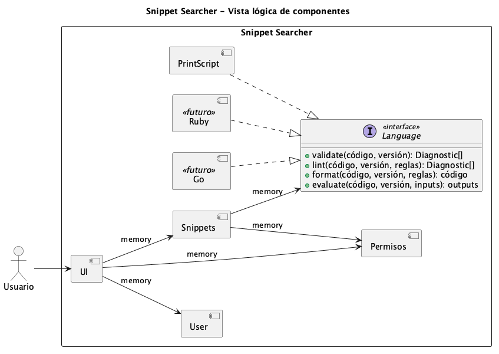
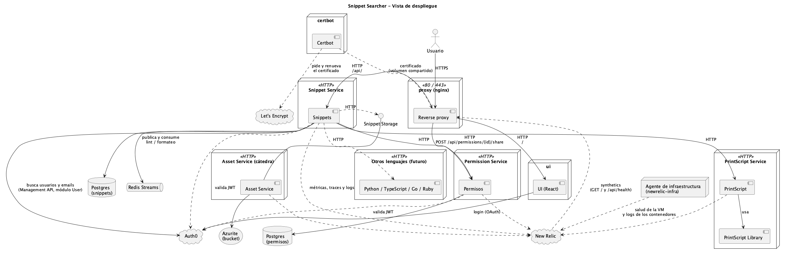
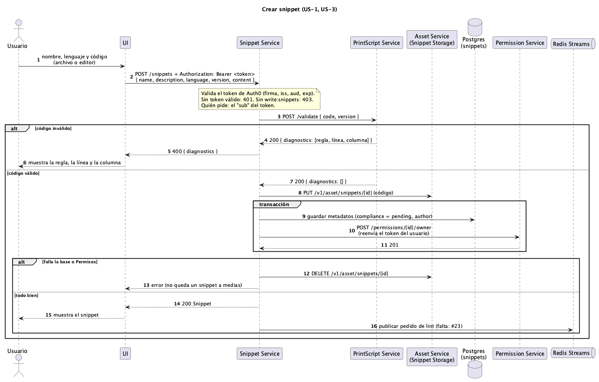
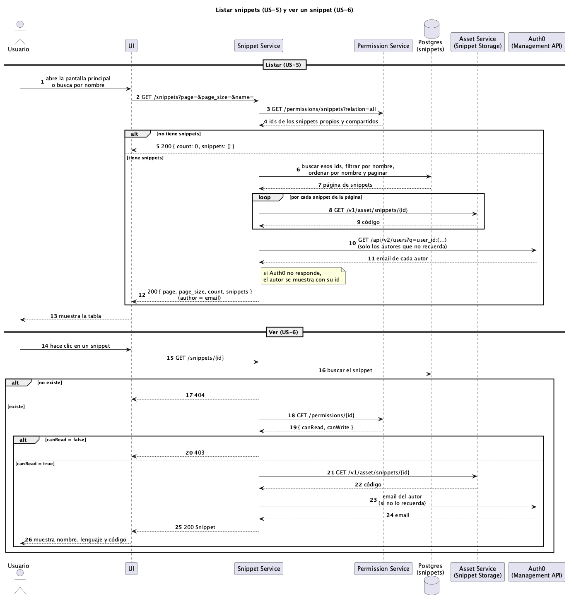
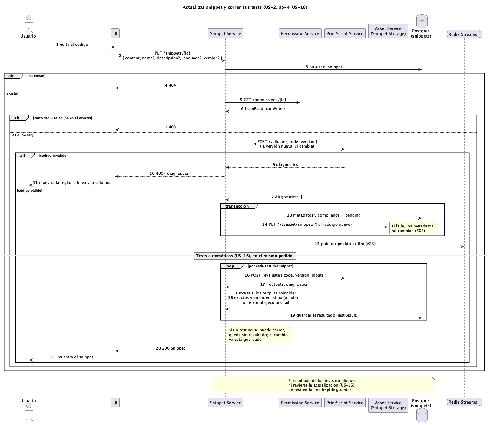
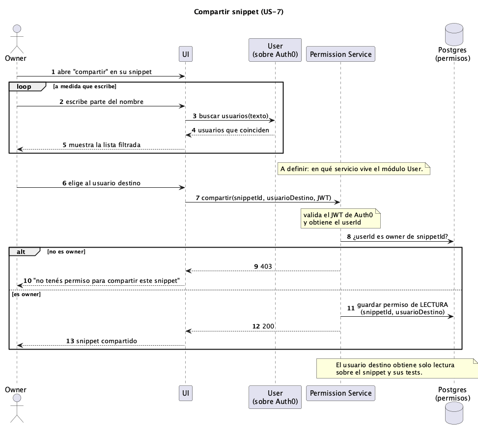
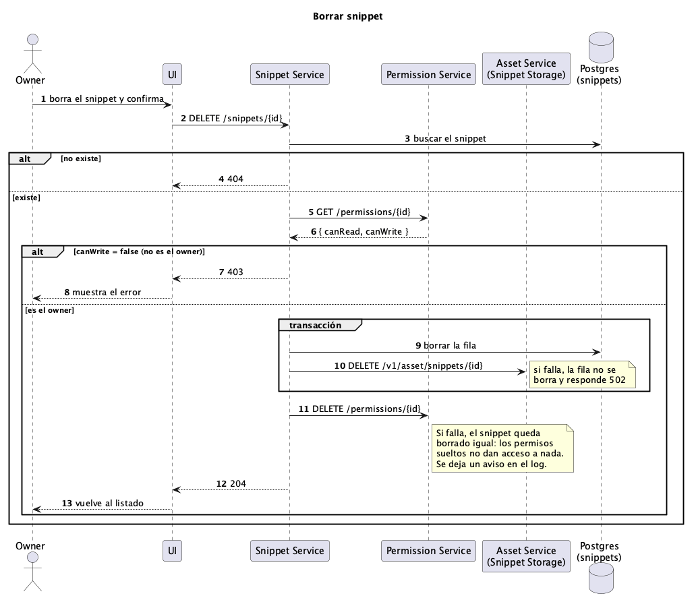
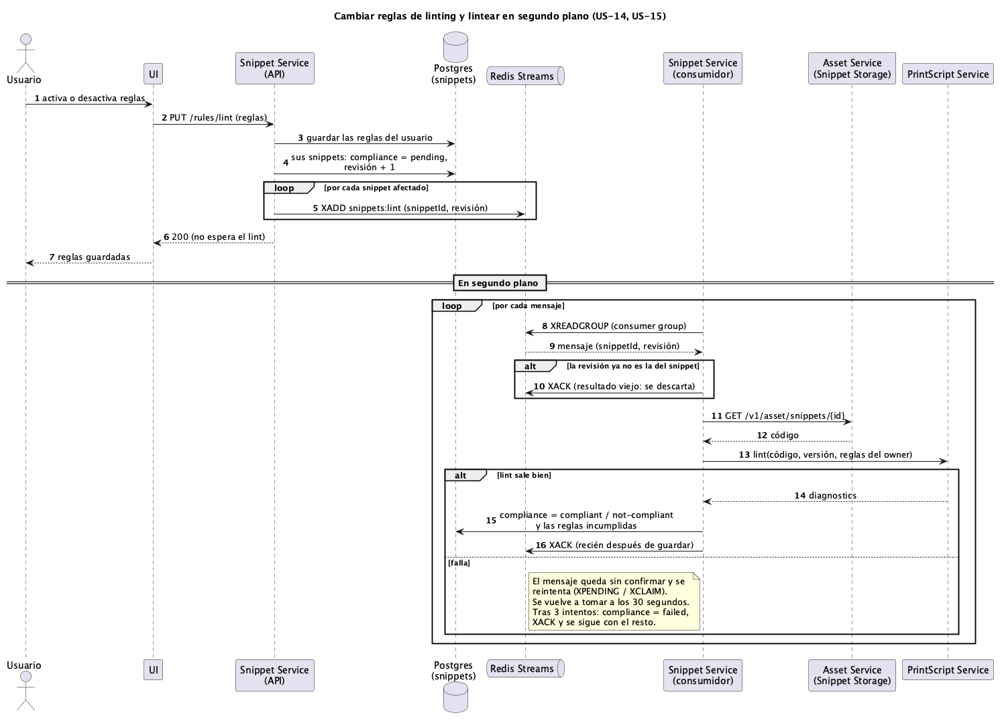

# SnippetSearcher

Plataforma web para guardar, compartir, ejecutar, formatear, lintear y testear snippets de código. Por ahora el único lenguaje soportado es **PrintScript**, pero la plataforma tiene que estar preparada para sumar otros lenguajes.

Trabajo práctico de Ingeniería de Sistemas, Universidad Austral (2026).

## Documentación de la cátedra

| Documento | Contenido |
|---|---|
| [Consigna](docs/Snippet%20Searcher%20-%20Consigna%20%281%29.pdf) | Descripción del TP, casos de uso generales y primer entregable |
| [Casos de uso (User Stories)](docs/Snippet%20Searcher%20-%20Casos%20de%20uso.pdf) | Las 16 user stories con sus notas y criterios |
| [Observabilidad](docs/08-observabilidad.pdf) | Clase de New Relic: logs, métricas, traces, synthetics, SLI/SLO y alertas |

## Casos de uso generales

- Guardar, editar, compartir, ejecutar, formatear y validar snippets.
- Definir casos de prueba para los snippets.
- Re-evaluar y validar **todos** los snippets con cada nueva versión del parser.
- Sin usuarios anónimos: todo acceso requiere autenticación/autorización (se delega en **Auth0**).

A lo largo del cuatrimestre se irán sumando requerimientos no funcionales.

## Primer entregable

- [ ] Arquitectura de la plataforma: UI web, N servicios, bases de datos, etc.
- [ ] User stories que reflejen las funcionalidades.
- [x] Diagrama de componentes de la arquitectura ([ver](#arquitectura)).
- [x] Diagramas de secuencia de los workflows más importantes ([ver](#diagramas-de-secuencia)).

## User stories

Los roles (desarrollador, administrador, investigador, owner) indican el punto de vista de cada historia. La cátedra aclara que no hace falta habilitar funciones por rol, pero que en el futuro podría pedirlo. Ver [Roles](#roles).

| # | Historia | Rol | Puntos clave |
|---|---|---|---|
| 1 | Crear snippet mediante archivo | Desarrollador | Nombre, descripción, lenguaje y versión. Se rechaza si no parsea, indicando la regla violada, la línea y la columna. |
| 2 | Actualizar snippet mediante archivo | Desarrollador | El owner puede actualizar el contenido y todos los metadatos. Se aplica la misma validación. |
| 3 | Crear snippet en editor | Desarrollador | Editor embebido en el browser, con los mismos requisitos que la #1. |
| 4 | Actualizar snippet en editor | Desarrollador | Mismos requisitos que la #2. |
| 5 | Listar snippets | Administrador | Filtro por relación (propios, compartidos o ambos). Muestra la validez según el linting. Permite filtrar y ordenar por nombre, lenguaje y validez. |
| 6 | Ver un snippet | Administrador | Muestra nombre, descripción, lenguaje, contenido, reglas de linting incumplidas y tests (ejecutables). |
| 7 | Compartir snippet | Owner | Selector de usuarios con filtro a medida que se escribe. El usuario invitado tiene permiso de **solo lectura** sobre el snippet y sus tests. |
| 8 | Crear tests | Desarrollador | Un test es una lista ordenada de inputs y otra de outputs esperados (en el orden de los `println`). Se permiten tests que fallan. |
| 9 ⏳ | Correr un test | Investigador | Un test a la vez, con el output en streaming. |
| 10 ⏳ | Ejecución interactiva | Investigador | El usuario da los inputs a medida que se piden y ve los outputs a medida que se imprimen. |
| 11 | Habilitar reglas de formateo | Administrador | Activar y desactivar reglas. Por ahora solo las reglas predeterminadas de PrintScript. |
| 12 ⏳ | Formateo automático | Administrador | Asíncrono y tolerante a fallos: retoma desde donde falló o saltea el snippet problemático. |
| 13 | Descargar snippet | Investigador | Versión original y versión formateada. |
| 14 | Habilitar reglas de linting | Administrador | Activar y desactivar reglas. Por ahora solo las predeterminadas de PrintScript. |
| 15 ⏳ | Linting automático | Administrador | Asíncrono y tolerante a fallos, igual que la #12. |
| 16 | Testing automático | Desarrollador | Al modificar un snippet se corren todos sus tests. El resultado **no** bloquea ni revierte el update. |

⏳ = la cátedra va a explicar más adelante cómo implementarlas.

> No hay que desarrollar la UI; solo configurarla para que funcione con nuestros servicios.

## Implicancias técnicas a tener en cuenta

Conclusiones que surgen de la consigna y conviene considerar al diseñar la arquitectura:

- **Multi-lenguaje desde el diseño.** El lenguaje y su versión son atributos del snippet. El parser, linter, formatter y runner deberían estar detrás de una abstracción por lenguaje.
- **Errores con ubicación.** La validación tiene que devolver la regla violada, la línea y la columna, no solo un "inválido".
- **Procesamiento masivo asíncrono.** El formateo y linting automáticos (#12, #15) y la re-validación por nueva versión del parser recorren muchos snippets. Hacen falta jobs en background con reintentos, checkpoints y la posibilidad de saltear snippets que fallen (por ejemplo, una cola de mensajes).
- **Ejecución con streaming bidireccional.** Las historias #9 y #10 piden inputs y outputs en tiempo real (por ejemplo, WebSockets o SSE), no una respuesta al final.
- **Permisos por snippet.** Hay owners y usuarios con acceso de lectura. La autenticación se delega en Auth0 y la autorización sobre cada snippet es nuestra.
- **Dos versiones del contenido.** Hay que guardar (o poder generar) la versión original y la formateada (#13).

## Definiciones a considerar
- Un snippet es un fragmento chico de código que se guarda para reutilizarlo, compartirlo o consultarlo después.
- Snippet Searcher: es una plataforma que entiende el código no lo guarda como texto plano, sino que tiene detrás el intérprete y las herramientas de PrintScript para trabajar con él.

## Qué se puede hacer con un snippet?
1. Validar (parsear). Si el código no respeta la sintaxis de PrintScript, no
   se guarda. Hay que indicar qué regla se rompió, en qué línea y en qué
   columna.
2. Lintear. Detecta problemas de estilo o de calidad aunque el código sea
   válido. Un ejemplo sería una regla del tipo "las variables en camelCase".
   El snippet se guarda igual, pero queda marcado como que no cumple.
3. Formatear. Reescribe el código para que cumpla las reglas de estilo, por
   ejemplo espacios o saltos de línea.
4. Ejecutar. Corre el snippet de forma interactiva: si llama a readInput, la
   plataforma le pide el valor al usuario en ese momento, y los println se ven a medida que ocurren.
5. Testear. Un test es una lista de inputs y una lista de outputs esperados.
   Se ejecuta el snippet con esos inputs y se compara lo que imprime con lo
   esperado. Los tests se corren solos cada vez que se modifica el snippet.
6. Compartir y descargar.


## Ejemplo de un snippet

Un snippet completo tal como viviría en la plataforma: código, metadatos, tests y qué pasa al validarlo, lintearlo y formatearlo.

### Ejemplo con código (PrintScript 1.1)
```
const nombre: string = readInput("Nombre:");
const mayor: boolean = readInput("¿Sos mayor de edad?");

let saludo: string = "Hola " + nombre;
println(saludo);

if (mayor) {
    println("Sos mayor de edad");
} else {
    println("Sos menor de edad");
}
```

`const`, `readInput`, `boolean` e `if/else` existen a partir de PrintScript 1.1; la 1.0 solo tiene `let`, `println` y expresiones. PrintScript no tiene comparaciones (`>`, `==`): el `if` recibe un valor `boolean`. Por eso el ejemplo pregunta directamente si es mayor de edad.

### Qué guarda la plataforma

| Dato | Valor | Dónde se guarda |
|---|---|---|
| id | `42` | Postgres (snippets) |
| Nombre | `saludo-por-edad` | Postgres (snippets) |
| Descripción | "Saluda al usuario y le dice si es mayor de edad" | Postgres (snippets) |
| Lenguaje / versión | PrintScript `1.1` | Postgres (snippets) |
| Estado de lint | `COMPLIANT` | Postgres (snippets) |
| Contenido | el código de arriba | Bucket (Snippet Storage) |
| Owner | `auth0\|martina` | Permisos |
| Compartido con | `auth0\|juan` (solo lectura) | Permisos |

### Tests (#8)
Los inputs se entregan en orden a cada `readInput`, y los outputs esperados se comparan en orden con cada `println`.

| Test | Inputs | Outputs esperados | Resultado |
|---|---|---|---|
| mayor de edad | `["Ana", "true"]` | `["Hola Ana", "Sos mayor de edad"]` | ✅ pasa |
| menor de edad | `["Leo", "false"]` | `["Hola Leo", "Sos menor de edad"]` | ✅ pasa |
| test mal escrito | `["Ana", "true"]` | `["Hola Ana", "Sos menor de edad"]` | ❌ falla (la consigna permite guardar tests así) |

Cada vez que se edita el snippet, sus tests se corren automáticamente (#16).

Los textos de `readInput` ("Nombre:", "¿Sos mayor de edad?") **no** cuentan como outputs: solo los `println` (ver **Tests de un snippet** en Decisiones técnicas).

### Qué pasa con versiones "malas" del snippet

**Error de sintaxis: el snippet se rechaza (#1)**

```
let saludo: string = "Hola " + nombre
println(saludo);
```

> ❌ Snippet inválido: falta `;` al final de la declaración (regla `MISSING_SEMICOLON`). Línea 2, columnas 1 a 7.

La posición es la del `println`: como la línea 1 no termina con `;`, la declaración sigue, y la librería marca el lugar donde esperaba el `;`.

No se guarda nada.

**Válido pero no cumple el linter: se guarda y queda marcado**

```
let mi_saludo: string = "Hola " + nombre;
println("Hola " + nombre);
```

> ⚠️ `mi_saludo` no respeta el formato camelCase (línea 1, columna 5).
> ⚠️ `println` solo acepta un identificador o un literal, no una expresión (línea 2, columna 9).

El snippet queda en estado `NOT_COMPLIANT`, visible en el listado (#5) y en el detalle (#6).

**Formato desprolijo: el formatter lo corrige (#11, #12)**

Antes:

```
let   edad:number=readInput("Edad:");println(edad);
```

Después:

```
let edad: number = readInput("Edad:");
println(edad);
```

La descarga (#13) ofrece las dos versiones: la original y la formateada.

### Ejecución interactiva (#10)

```
> Nombre:        ← la plataforma pide el input
  Martina        ← el usuario escribe
< Hola Martina   ← el output aparece en el momento
> ¿Sos mayor de edad?
  true
< Sos mayor de edad
```

Las reglas concretas de lint y formateo (camelCase o snake_case, espacios alrededor de `:` y `=`, saltos de línea antes de `println`, indentación del `if`, etc.) dependen de la versión de PrintScript que provea la cátedra. Las de arriba son ejemplos ilustrativos.

## Arquitectura

La arquitectura sigue el formato que propusieron los profesores en clase ([foto del pizarrón](docs/diagramas/PizarronArquitecturaDiagrama.jpeg)). Se describe en dos diagramas de componentes UML, escritos en PlantUML dentro de [`docs/diagramas/`](docs/diagramas):

| Diagrama | Fuente | Qué muestra |
|---|---|---|
| Vista lógica | [`componentes-logico.puml`](docs/diagramas/componentes-logico.puml) | Los módulos del sistema, la interfaz `Language` y cómo dependen entre sí, sin importar cómo se despliegan |
| Vista de despliegue | [`componentes-despliegue.puml`](docs/diagramas/componentes-despliegue.puml) | Qué servicios HTTP existen, qué base de datos usa cada uno, dónde se guarda el código y cómo interviene Auth0 |

### Vista lógica

Las conexiones `memory` indican que, a nivel lógico, los módulos se llaman como si estuvieran en el mismo proceso. La clave de este diagrama es que **Snippets depende de la interfaz `Language` y no de PrintScript directamente**. Cada lenguaje (PrintScript hoy; Go o Ruby en el futuro) implementa esa interfaz, así que agregar un lenguaje no requiere modificar Snippets.

### Vista de despliegue

Todo entra por el **proxy** (nginx), con HTTPS: le pasa `/` a la UI, el pedido de compartir (`POST /api/permissions/{id}/share`) a Permisos y el resto de `/api/` a Snippets. Es el único servicio con puertos públicos. El servicio `certbot` le consigue y le renueva el certificado de Let's Encrypt. Ver [Contrato con la UI](#contrato-con-la-ui).

Cada módulo se despliega como un servicio independiente con API HTTP. Snippets y Permisos tienen **cada uno su propio Postgres**. El **código de los snippets no va a Postgres**: se guarda en un bucket, detrás de la interfaz `Snippet Storage`. Solo Snippets lo lee y lo escribe: a los servicios de lenguaje les manda el código en cada pedido.

### Diagramas de secuencia

Los flujos más importantes, en PlantUML dentro de [`docs/diagramas/flujos/`](docs/diagramas/flujos). Usan los endpoints reales del [Contrato con la UI](#contrato-con-la-ui) y de [Decisiones técnicas](#decisiones-técnicas). Lo que todavía no está decidido se marca **A definir** o **Pendiente** en el diagrama.

| Flujo | User stories | Estado | Qué muestra |
|---|---|---|---|
| [Crear snippet](docs/diagramas/flujos/secuencia-crear-snippet.puml) | US-1, US-3 | ✅ Implementado (falta el lint, #23) | Validación con regla, línea y columna; el código va al Asset Service; los metadatos y el owner se guardan en una transacción, y si falla se borra el archivo |
| [Listar y ver](docs/diagramas/flujos/secuencia-listar-y-ver-snippet.puml) | US-5, US-6 | ✅ Implementado | Permisos dice qué snippets ve el usuario; 404 si no existe y 403 sin acceso |
| [Actualizar snippet](docs/diagramas/flujos/secuencia-actualizar-snippet.puml) | US-2, US-4, US-16 | ✅ Implementado (falta el lint, #23) | Solo el owner edita; misma validación que crear; si falla guardar el código, los metadatos no cambian; los tests corren después y no revierten el cambio |
| [Compartir snippet](docs/diagramas/flujos/secuencia-compartir-snippet.puml) | US-7 | ✅ Implementado (falta la búsqueda de usuarios, módulo User) | Solo el owner comparte; el invitado solo lee; 400 si se lo comparte a sí mismo; compartir dos veces no duplica el permiso |
| [Borrar snippet](docs/diagramas/flujos/secuencia-borrar-snippet.puml) | — | ✅ Implementado | Solo el owner borra; la fila y el archivo en una transacción; después los permisos, y si eso falla el snippet queda borrado igual |
| [Linting automático](docs/diagramas/flujos/secuencia-linting-automatico.puml) | US-14, US-15 | ⏳ Falta (#23) | Snippet Service se manda trabajo a sí mismo por Redis Streams (un stream por tarea); confirma el mensaje recién después de guardar y reintenta hasta 3 veces. El formateo automático (US-12) sigue el mismo flujo |













## Roles
La cátedra lo aclara en las [user stories](docs/Snippet%20Searcher%20-%20Casos%20de%20uso.pdf):

> Las User Stories detallan distintos usuarios: administrador, desarrollador, investigador. Esto no quiere decir que tengan que habilitar las funcionalidades por tipo de usuario, es simplemente para que entiendan el punto de vista de cada caso de uso. En el futuro sí podríamos decidir habilitar o deshabilitar funcionalidades según el rol.

Por eso el sistema tiene el mecanismo de roles armado, pero hoy todos los usuarios reciben el mismo rol, con todos los permisos. Cada pedido pasa por tres controles:

| Control | Pregunta | Quién responde | Si falla |
|---|---|---|---|
| 1. Autenticación | ¿Quién sos? | **Auth0**: el usuario inicia sesión y recibe un token que dice quién es (`sub`) | **401** |
| 2. Permiso de la API | ¿Qué tipo de cosas podés hacer? | **Auth0** pone en el token los permisos del rol del usuario (`read:snippets`, `write:snippets`), y cada servicio los revisa | **403** |
| 3. Dueño | ¿Sobre cuál snippet? | **Permission Service**: el owner lee, edita, borra y comparte; el usuario con acceso compartido solo lee | **403** |

Si la cátedra pide roles distintos, se crean en Auth0 y se reparten los permisos. El código de los servicios no cambia. Ver **Roles y permisos** en [Decisiones técnicas](#decisiones-técnicas).

Los roles de las user stories:

| Rol | Qué hace | User stories |
|---|---|---|
| **Desarrollador** | Crea y actualiza snippets (desde un archivo o desde el editor), escribe tests y espera que se corran solos al modificar el código | #1, #2, #3, #4, #8, #16 |
| **Administrador** | Gestiona un conjunto de snippets: los lista, filtra y ordena, ve su detalle y su validez, y configura las reglas de linting y formateo que se aplican a todos ellos | #5, #6, #11, #12, #14, #15 |
| **Investigador** | Estudia snippets a los que tiene acceso: los ejecuta de forma interactiva, corre sus tests y los descarga | #9, #10, #13 |
| **Owner** | El creador del snippet. Es el único que puede editarlo, borrarlo y compartirlo | #2, #7 |
| **Usuario con acceso compartido** | Alguien con quien el owner compartió un snippet. Tiene permiso de **solo lectura** sobre el snippet y sus tests | #7 |

Todos los roles son usuarios autenticados con Auth0: no existen usuarios anónimos.

## Módulos

| Módulo | Responsabilidad | Guarda datos en |
|---|---|---|
| **UI** | Interfaz web (React) provista por la cátedra: pantallas, editor embebido, login. Solo hay que configurarla para que apunte a nuestros servicios. Vive en [SnippetSearcher-ui](https://github.com/MartinaCousido/SnippetSearcher-ui). En la VM la sirve el contenedor `ui`, detrás del proxy | — |
| **Auth0** (externo) | Login, emisión de tokens JWT y registro de usuarios | Auth0 |
| **User** | Expone los usuarios del sistema: la búsqueda que filtra a medida que se escribe al compartir un snippet (#7) y el email del autor en el listado. Se apoya en Auth0, no mantiene una tabla de usuarios propia. Vive en Snippet Service, en el paquete `users/` (ver **Módulo User** en [Decisiones técnicas](#decisiones-técnicas)) | Auth0 |
| **Snippets** | Módulo central. Guarda los metadatos del snippet (nombre, descripción, lenguaje, versión, estado de lint), los tests y la configuración de reglas. Orquesta la validación, el lint, el formateo y la ejecución delegándolas en el lenguaje correspondiente | Postgres (snippets) + Snippet Storage |
| **Permisos** | Decide quién puede hacer qué sobre cada snippet: registra al owner y a los usuarios con quienes se compartió, y responde consultas del tipo "¿este usuario puede leer o escribir este snippet?" | Postgres (permisos) |
| **Language** (interfaz) | Contrato común que todo lenguaje debe cumplir: `validate` (sintaxis y semántica, sin ejecutar), `lint`, `format` y `evaluate` (ejecutar). Recibe el código del snippet, no su id. Los errores y las reglas incumplidas vuelven como `Diagnostic` | — |
| **PrintScript** | Implementación de `Language` para PrintScript. Es un servicio propio, en [SnippetPrintScript](https://github.com/MartinaCousido/SnippetPrintScript), que usa la **PrintScript Library** ([MartinaCousido/PrintScript](https://github.com/MartinaCousido/PrintScript): lexer, parser, intérprete, linter y formatter) | — |
| **Otros lenguajes** (futuro) | Python, TypeScript, Go, Ruby, etc. Serían nuevas implementaciones de `Language`, desplegadas como servicios iguales a PrintScript | — |
| **Snippet Storage** (interfaz) / **Asset Service** | Guarda y entrega el contenido (código) de los snippets como archivos en un bucket. Lo implementa el Asset Service de la cátedra, sobre Azurite | Bucket (Azurite) |

## Dependencias entre módulos

| Módulo | Depende de | Para qué |
|---|---|---|
| UI | Auth0 | Iniciar sesión y obtener el token |
| UI | Snippets | Todas las operaciones sobre snippets, tests y reglas |
| UI | Permisos | Compartir snippets y consultar accesos |
| UI | User | Buscar usuarios al compartir |
| Snippets | Permisos | Verificar que el usuario puede leer o modificar un snippet, y registrar al owner al crearlo |
| Snippets | Language (PrintScript) | Validar, lintear, formatear y ejecutar el código |
| Snippets | Snippet Storage | Guardar y leer el contenido del snippet |
| Snippets | Redis | Publicar y consumir los trabajos de lint y formateo en segundo plano |
| Snippets, Permisos | Auth0 | Validar el JWT de cada request y obtener el `userId` |
| PrintScript | PrintScript Library | Toda la lógica del lenguaje |

Reglas de diseño que salen de estas dependencias:

- **Nadie depende de Snippets salvo la UI.** Snippets orquesta; Permisos, los lenguajes y el storage no conocen a Snippets.
- **Snippets no conoce ningún lenguaje concreto**, solo la interfaz `Language`.
- **Cada servicio es dueño de sus datos.** Snippets no lee la base de Permisos ni al revés: se comunican por HTTP.
- **No hay dependencias circulares.**

La cola de mensajes (Redis Streams) para el formateo y linting en segundo plano (#12, #15) la publica y la consume el mismo Snippet Service. Los servicios de lenguaje no la conocen: siguen siendo HTTP simple.

## Ejemplo: crear un snippet de punta a punta

1. La UI manda `POST /snippets` al Snippet Service con el código y el token de Auth0.
2. El Snippet Service valida el token y obtiene el `userId`.
3. Pide al servicio del lenguaje (PrintScript) que valide el código:
   - Si es inválido, responde **400** con la regla violada, la línea y la columna.
4. Si es válido:
   - guarda el contenido en **Snippet Storage**;
   - guarda los metadatos en **Postgres (snippets)**;
   - registra al usuario como owner en **Permisos**.
5. Marca el snippet como `PENDING` y publica un mensaje en Redis Streams. El endpoint responde sin esperar.
6. En segundo plano, Snippet Service lintea el snippet y actualiza su estado (`COMPLIANT`, `NOT_COMPLIANT` o `FAILED`).
7. Corre los tests del snippet, si tiene (#16).

## Contrato con la UI

La UI de la cátedra le pide todo al backend a través de la interfaz `SnippetOperations` (`src/utils/snippetOperations.ts` en [SnippetSearcher-ui](https://github.com/MartinaCousido/SnippetSearcher-ui)). Nuestra implementación, `ApiSnippetOperations`, llama a estos endpoints.

### Una sola URL, con reverse proxy

La UI tiene una sola variable, `BACKEND_URL`, y los tests de Cypress de la cátedra la usan así (`BACKEND_URL + "/snippets"`). Por eso la UI no conoce a cada servicio: le habla a un **reverse proxy**, que recibe todos los pedidos en una dirección y le pasa cada uno al servicio que corresponde según la ruta.

| Ruta que pide la UI | Va a |
|---|---|
| `/api/snippets…`, `/api/rules…`, `/api/languages`, `/api/users` | Snippet Service |
| `GET /api/health` (público, sin token) | Snippet Service: `UP` (200) o `DOWN` (503) si no responde la base, Redis, Permission, PrintScript o el Asset Service. Sin detalles: lo usan los synthetics de New Relic. Qué falló queda en el log |
| `POST /api/permissions/{id}/share` | Permission Service |

- El proxy **saca el `/api`**: los servicios exponen `/snippets`, `/permissions`, etc., sin prefijo. Así su código no depende de cómo se publiquen.
- Todo lo que no empieza con `/api` va a la UI.
- De Permission Service se publica solo compartir: el resto de sus endpoints los usa Snippet Service por la red interna. Tampoco se publica `/api/actuator` (el health de los servicios). Los dos responden 404 desde afuera (ver [Reverse proxy](https://github.com/MartinaCousido/SnippetSearcher-infra#reverse-proxy) en el repo de infra).

| Dónde | Proxy | `BACKEND_URL` |
|---|---|---|
| Local | El proxy del servidor de desarrollo de Vite (`vite.config.ts` de la UI) | `http://localhost:5173/api` |
| VM de dev | `proxy` (nginx) en `docker-stack.yml`, en los puertos 80 y 443. Le pasa `/` al contenedor `ui` | `https://snippetsearcher-dev.duckdns.org/api` |
| VM de prod | Igual que dev | `https://snippetsearcher-prod.duckdns.org/api` |

En la VM, `BACKEND_URL` es `/api`, relativa a la página. Así la misma imagen de la UI sirve para dev y prod.

### HTTPS

- Los usuarios entran por **HTTPS**, con un certificado de **Let's Encrypt** (una autoridad que da certificados gratis) para el dominio de **DuckDNS** (un servicio gratis que le da un nombre a la IP de la VM).
- El cifrado termina en el `proxy`. Adentro de la red de Docker, el proxy les habla a los servicios con HTTP.
- `http://…` redirige a `https://…`.
- La primera vez, mientras llega el certificado real, el proxy usa uno provisorio y el navegador avisa que no es seguro. Detalle en [HTTPS](https://github.com/MartinaCousido/SnippetSearcher-infra#https) del repo de infra.

### CORS

CORS es la regla del navegador que decide si una página puede llamar a una API que está en otra dirección (otro *origin*). Con el proxy, la UI y la API están en el mismo origin, así que el navegador no la aplica. Igual se configura, por si la UI se sirve desde otra dirección:

- Snippet Service y Permission Service aceptan solo los origins de la variable **`CORS_ALLOWED_ORIGINS`** (lista separada por comas). Nunca `*`: si la lista lo tiene, el servicio no arranca. Sin la variable, no se acepta ningún origin externo. En el `docker-compose.yml` local vale `http://localhost:5173`.
- Métodos: `GET`, `POST`, `PUT`, `DELETE` y `OPTIONS`. Headers: `Authorization` y `Content-Type`.

| Ambiente | `CORS_ALLOWED_ORIGINS` |
|---|---|
| dev | `https://snippetsearcher-dev.duckdns.org,http://localhost:5173` |
| prod | `https://snippetsearcher-prod.duckdns.org` |

### Endpoints

| Método de la UI | Endpoint | Respuesta |
|---|---|---|
| `listSnippetDescriptors(page, pageSize, name?)` | `GET /snippets?page=&page_size=&name=` | `{ page, page_size, count, snippets: Snippet[] }`. `page` empieza en 0 y `page_size` va de 1 a 100. `name` filtra por nombre (contiene, sin distinguir mayúsculas). Ordenado por nombre. `relation=owner\|shared\|all` elige propios, compartidos o ambos; la UI no lo manda, así que por defecto son ambos |
| `createSnippet(snippet)` | `POST /snippets` | `Snippet`. **400** con `{ diagnostics: Diagnostic[] }` si el código no es válido. **400** si el código está vacío o tiene solo espacios (el Snippet Storage no acepta archivos vacíos) |
| `getSnippetById(id)` | `GET /snippets/{id}` | `Snippet`, con las reglas de lint que incumple (`lintViolations`, US-6). 404 si no existe, 403 si no tiene acceso |
| `updateSnippetById(id, {content})` | `PUT /snippets/{id}` con `{ content, name?, description?, language?, version? }` | `Snippet`. `content` es obligatorio; los metadatos son opcionales y el que no viene queda como estaba (la UI de la cátedra manda solo `content`, pero la US-2 permite cambiar todos). Si cambian el lenguaje o la versión, se valida con los nuevos. Misma validación y errores que crear: si es inválido, no se cambia nada. El snippet vuelve a `pending`. 404 si no existe, 403 si no es el owner |
| `deleteSnippet(id)` | `DELETE /snippets/{id}` | 204. Solo el owner: 403 si no lo es, 404 si no existe. Borra la fila, el archivo del Snippet Storage y los permisos del snippet en Permission Service. Si borrar los permisos falla, el snippet queda borrado igual |
| `shareSnippet(snippetId, userId)` | `POST /permissions/{snippetId}/share` y después `GET /snippets/{snippetId}` | El `Snippet` |
| `getFileTypes()` | `GET /languages` | `[{ language, extension }]`, de la configuración de lenguajes de Snippet Service |
| `downloadSnippet(snippetId, formatted)` | `GET /snippets/{id}/download?formatted=false\|true` | El archivo como descarga (`text/plain`): `<nombre>.<extensión>` con el código original, o `<nombre>-formateado.<extensión>` con la versión formateada que guardó el formateo en segundo plano (US-13). Lo descargan el owner y los usuarios con acceso compartido: 403 si no tiene acceso, 404 si no existe. **404** con "Este snippet todavía no tiene versión formateada" si todavía se está formateando o no se pudo formatear |
| `formatSnippet(snippetId, content)` | `POST /snippets/{id}/format` con `{ content }` | `{ content }` con el código formateado, según las reglas de formateo del owner. No guarda nada. Si el formateador falla, **400** con `{ diagnostics }`, igual que un código inválido. Lo pueden usar el owner y los usuarios con acceso compartido |
| `getFormatRules()` / `modifyFormatRule(rules)` | `GET` / `PUT /rules/format` | `Rule[]` del usuario: todas las reglas de formateo de PrintScript, con lo que el usuario activó y sus valores, o los valores por defecto si no cambió nada. `PUT` recibe la lista completa y responde la lista guardada. **400** si activa las dos reglas de un par opuesto, si una regla no existe o si un valor no sirve |
| `getLintingRules()` / `modifyLintingRule(rules)` | `GET` / `PUT /rules/lint` | `Rule[]` del usuario, igual que las de formateo |
| `getTestCases(snippetId)` | `GET /snippets/{id}/tests` | `TestCase[]`, cada uno con el resultado de su última corrida. Lo ven el owner y los usuarios con acceso compartido |
| `postTestCase(snippetId, test)` | `POST /snippets/{id}/tests` con `{ id?, name, input, output }` | `TestCase`. Sin `id` crea un test; con `id`, cambia ese test y borra su último resultado. `name` es obligatorio (400). Se guarda aunque el test no pase (US-8). Solo el owner: 403 si no lo es, 404 si el snippet o el test no existen |
| `removeTestCase(snippetId, testId)` | `DELETE /snippets/{id}/tests/{testId}` | 204. Solo el owner. 404 si el test no existe o es de otro snippet |
| `testSnippet(snippetId, test)` | `POST /snippets/{id}/tests/run` con `{ id?, input, output }` | `{ result: "success" \| "fail" }`. `success` si los outputs coinciden exactamente y en orden con los esperados. Un error al ejecutar es `fail`. Corre con el código guardado del snippet. Si viene el `id` de un test guardado y se corre tal como está guardado, también guarda el resultado (`lastResult`); con cambios sin guardar, no. Lo pueden correr el owner y los usuarios con acceso compartido |
| `getUserFriends(name, page, pageSize)` | `GET /users?name=&page=&page_size=` | `{ page, page_size, count, users: [{ id, name }] }`: `id` es el `sub` (el que se manda al compartir) y `name` es el email. `name` filtra por el comienzo del email, sin distinguir mayúsculas; sin `name`, lista a todos. Nunca incluye a quien pide. `page` empieza en 0 y `page_size` va de 1 a 100. Los usuarios se buscan en Auth0 (módulo User). 502 si Auth0 no responde |

Todos los pedidos llevan el token de Auth0 (`Authorization: Bearer …`).

- Sin token, o con un token vencido o de otra API: **401**.
- Sin el permiso que pide la operación: **403**.
  - `read:snippets`: los `GET`, correr un test (`POST /snippets/{id}/tests/run`) y formatear sin guardar (`POST /snippets/{id}/format`).
  - `write:snippets`: el resto de los `POST`, `PUT` y `DELETE` (crear, editar, borrar, compartir, crear y borrar tests, cambiar reglas).
- Además, cada operación sobre un snippet revisa en Permission Service si el usuario es el owner o tiene acceso compartido (los 403 de la tabla).

### Formatos

```
Snippet  = { id, name, description, language, version, extension, content, compliance, author, lintViolations: Diagnostic[] }
Rule     = { id, name, isActive, value }   // id y name: el nombre de la regla en la librería. value: null en las de sí o no; texto o número en las demás
TestCase = { id, name, input: string[], output: string[], lastResult: "success" | "fail" | null }
```

- `compliance` usa los valores de la UI: `pending`, `failed`, `not-compliant`, `compliant`.
- `author` es el **email** del owner. En la base se guarda solo su `userId` (el `sub` del token, por ejemplo `auth0|abc123`), y el email se le pide a Auth0 (módulo User): un pedido por página del listado, y se recuerda 10 minutos. Si Auth0 no lo devuelve (por ejemplo, el usuario viejo `dev-user`) o no responde, `author` es el `userId`.
- `description` y `version` no los manda la UI de la cátedra: son opcionales al crear. La versión toma la `default-version` del lenguaje: para PrintScript es **`1.1`**.
- `Diagnostic` es el formato de [Decisiones técnicas](#decisiones-técnicas): `{ rule, message, range: { start: { line, column }, end: { line, column } } }`.

### Cambios a la UI de la cátedra

- **`snippetId` en los métodos de tests y de formateo** (`getTestCases`, `postTestCase`, `removeTestCase`, `testSnippet`, `formatSnippet`). La interfaz original no lo recibe, y sin él no se sabe a qué snippet pertenece un test ni con qué lenguaje y reglas formatear. La pantalla de detalle ya tiene el snippet abierto.
- **Reglas de lint incumplidas** (US-6): `Snippet` suma `lintViolations`, y el detalle las muestra debajo del código. La UI original no tiene dónde mostrarlas.
- **Resultado de la última corrida de cada test** (US-16): `TestCase` suma `lastResult`, y la pantalla de tests lo muestra al lado del nombre. La UI original no tiene dónde mostrarlo.
- **Descargar** (US-13): `downloadSnippet` es un método nuevo. El botón de descarga ofrece la versión original y la formateada, y las dos se piden al backend con el token (antes descargaba el código que la pantalla ya tenía).
- **Todos los métodos llaman al backend:** `ApiSnippetOperations` ya no usa `FakeSnippetOperations`, la implementación falsa de la cátedra.

### Limitaciones conocidas

- La UI no permite filtrar el listado por relación (propios, compartidos o ambos), que pide la US-5. El endpoint lo acepta (`relation`), pero la UI no lo manda: muestra los dos.
- La UI tampoco permite filtrar ni ordenar por lenguaje o validez, que pide la US-5. El endpoint ordena por nombre.
- El listado incluye el `content` de cada snippet, porque el tipo `Snippet` de la UI lo tiene. Cada página lee esos archivos del Snippet Storage.

## Decisiones técnicas

Fuente de verdad sobre qué está decidido. Lo que figura como **Pendiente** no se asume: se consulta con el equipo antes de implementarlo, y la decisión se registra acá.

| Tema | Estado | Detalle |
|---|---|---|
| Arquitectura de servicios | ✅ Definido | Ver [Arquitectura](#arquitectura) y [Dependencias entre módulos](#dependencias-entre-módulos) |
| Autenticación | ✅ Definido | Auth0 (lo indica la cátedra) |
| Lenguaje, framework y build | ✅ Definido | **Java 25 + Spring Boot 4.1.1 + Gradle 9.8** (Groovy DSL, con wrapper) |
| Contenedores | ✅ Definido | Un `Dockerfile` por servicio; `docker-compose.yml` por repo y `docker-compose.sistema.yml` en este repo, que incluye los de cada repo para levantar todo. Todos comparten el proyecto `snippet-searcher`, así que los contenedores y los datos son los mismos se levante un servicio solo o el sistema. Ver [Cómo levantarlo](#cómo-levantarlo) |
| Publicación de la imagen | ✅ Definido | En cada push a `dev` o `main`, GitHub Actions (`.github/workflows/cd.yml`) arma la imagen y la publica en GHCR como `ghcr.io/martinacousido/snippet-service`, con el tag del ambiente (`dev` o `prod`) y el del commit (`sha-…`). La imagen es pública. Ver [Tags de las imágenes](https://github.com/MartinaCousido/SnippetSearcher-infra#tags-de-las-imágenes) en el repo de infra |
| Deploy del servicio | ✅ Definido | Después de publicar la imagen, el mismo workflow entra por SSH a la VM del ambiente (`dev` → VM de dev, `main` → VM de prod) y corre `docker service update` con el tag `sha-…` del commit. Actualiza **solo** `snippet-service`: los demás servicios del stack no se reinician. Usa los secrets `VM_HOST`, `VM_USER` y `VM_SSH_KEY` de los *Environments* `dev` y `prod` de este repo. La VM tiene que estar prendida |
| Librería de PrintScript | ✅ Definido | **[MartinaCousido/PrintScript](https://github.com/MartinaCousido/PrintScript) `0.3.1`**: copia propia e independiente de la librería del TP anterior (`ingsis-ua/ingsis-interpreter`), con Java 25. Se publica en GitHub Packages como `org.printscript:<módulo>:0.3.1` (por ejemplo `org.printscript:runner`), desde `https://maven.pkg.github.com/MartinaCousido/PrintScript`. Bajarla pide un token con `read:packages`, también en el CI y en el build de Docker del servicio que la use. La `0.3.1` formatea el cuerpo de un `if` escrito en una sola línea (MartinaCousido/PrintScript#23) |
| Repo de la UI | ✅ Definido | [SnippetSearcher-ui](https://github.com/MartinaCousido/SnippetSearcher-ui): un *fork* (copia vinculada) de la UI de la cátedra, [austral-ingsis/printscript-ui](https://github.com/austral-ingsis/printscript-ui). Con *Sync fork* se traen los cambios de la cátedra. No usa `dev`: `master` hace de `dev` y despliega en la VM de dev, y `main` despliega en la VM de prod (clase del 2026-10-20). Las ramas salen de `master`, los PRs van hacia `master`, y lo probado pasa a `main` con un PR `master` → `main`. Ver [Flujo de trabajo](#flujo-de-trabajo) |
| Imagen de la UI | ✅ Definido | Contenedor **`ui`** aparte en el stack, con la imagen `ghcr.io/martinacousido/snippet-ui` (tags `dev`/`prod` y `sha-…`, como los servicios). Sirve los archivos de la UI ya compilados. No tiene puertos: el `proxy` le pasa `/`. La publica el repo de la UI ([SnippetSearcher-ui#10](https://github.com/MartinaCousido/SnippetSearcher-ui/issues/10)) |
| Reverse proxy | ✅ Definido | Servicio **`proxy`** (nginx) en el stack, en los puertos **80 y 443**. Es el único con puertos públicos: Snippet Service deja de publicar el 80. Rutas en [Contrato con la UI](#contrato-con-la-ui). Detalle en [Reverse proxy](https://github.com/MartinaCousido/SnippetSearcher-infra#reverse-proxy) del repo de infra |
| HTTPS | ✅ Definido | **Let's Encrypt + DuckDNS** (clase del 2026-10-20). Dominios: `snippetsearcher-dev.duckdns.org` (dev) y `snippetsearcher-prod.duckdns.org` (prod). El cifrado termina en el `proxy`; adentro de la red de Docker se sigue con HTTP. `http://` redirige a `https://`. El servicio **`certbot`** del stack consigue y renueva el certificado. **Primer certificado:** nginx no arranca con HTTPS sin certificado, y Let's Encrypt necesita a nginx para comprobar el dominio; por eso, la primera vez, nginx arranca con un certificado **provisorio autofirmado** que crea `certbot`, y lo cambia por el real apenas llega (2026-10-25). Se implementa en [SnippetSearcher-infra#24](https://github.com/MartinaCousido/SnippetSearcher-infra/issues/24). Ver [HTTPS](#https) |
| CORS | ✅ Definido | Snippet Service y Permission Service aceptan solo los origins de **`CORS_ALLOWED_ORIGINS`**, con los métodos `GET`, `POST`, `PUT`, `DELETE` y `OPTIONS` y los headers `Authorization` y `Content-Type`. Nunca `*`. Dev: el dominio de dev y `http://localhost:5173`. Prod: solo el dominio de prod. Reemplaza a "no hace falta configurar CORS". Ver [CORS](#cors) |
| Contrato con Permission Service | ✅ Definido | Cinco endpoints. **Registrar owner:** `POST /permissions/{snippetId}/owner` → 201. Si ya es el owner, no hace nada y responde 201 igual (así Snippet Service puede reintentar); **409** si el snippet ya tiene otro owner, o si el usuario ya tiene otro permiso sobre el snippet. **Compartir:** `POST /permissions/{snippetId}/share` con `{ "userId": "auth0\|juan" }` → 201, o 403 si quien comparte no es el owner, o **400** si el owner se lo comparte a sí mismo. **¿Puede leer o escribir?:** `GET /permissions/{snippetId}` → `{ "canRead": true, "canWrite": false }`. **Snippets accesibles:** `GET /permissions/snippets?relation=owner\|shared\|all` → lista de ids. **Borrar los permisos de un snippet:** `DELETE /permissions/{snippetId}` → 204; lo llama Snippet Service al borrar un snippet, para no dejar permisos huérfanos. Si no hay permisos, 204 igual (se puede reintentar); **403** si quien pide no es el owner. El `userId` de quien pide sale siempre del JWT: Snippet Service le **reenvía el token del usuario**, nunca le manda el `userId`. Detalle en el [README de SnippetPermission](https://github.com/MartinaCousido/SnippetPermission#operaciones) |
| Contrato con la UI de la cátedra | ✅ Definido | Endpoints y formatos que salen de `src/utils/snippetOperations.ts`, más el reverse proxy que deja a la UI con una sola `BACKEND_URL`. Ver [Contrato con la UI](#contrato-con-la-ui) |
| Snippet Storage (bucket) | ✅ Definido | Lo provee la cátedra (clase del 2026-10-13): el **[Asset Service](https://github.com/austral-ingsis/asset-service)** (imagen `ghcr.io/austral-ingsis/snippet-asset-service`), sobre un bucket emulado con **Azurite**. Expone `GET`, `PUT` y `DELETE` en `/v1/asset/{container}/{key}`. En Postgres va solo la referencia al archivo. La imagen es pública: se baja sin login. Se suma al stack en [SnippetSearcher-infra#14](https://github.com/MartinaCousido/SnippetSearcher-infra/issues/14) |
| Servicio de PrintScript | ✅ Definido | **Repo propio: [SnippetPrintScript](https://github.com/MartinaCousido/SnippetPrintScript)**, con el mismo flujo que los otros servicios (`dev` → VM de dev, `main` → VM de prod), los mismos rulesets y los Environments `dev` y `prod`. No copia el código del lenguaje: usa la librería publicada en GitHub Packages (`org.printscript:runner:0.3.1`), y la baja con el secret `PACKAGES_TOKEN` del repo (token classic con solo `read:packages`). Se descartó ponerlo dentro del repo de la librería: ese repo trabaja solo con `master`, publica versiones de librería y no imágenes, y sumarle Spring Boot obligaba a mantener sus checksums en `verification-metadata.xml`. Imagen `ghcr.io/martinacousido/printscript-service`, nombre en el stack `printscript-service`, puerto local `8083`. Snippet Service lo encuentra con la variable `PRINTSCRIPT_SERVICE_URL` |
| Contrato del servicio de PrintScript | ✅ Definido | `POST /validate` con `{ "code": "...", "version": "1.1" }`. Responde **200** con `{ "diagnostics": [ { "rule": "MISSING_SEMICOLON", "message": "...", "range": { "start": { "line": 1, "column": 38 }, "end": { "line": 1, "column": 38 } } } ] }`, con el formato de `Diagnostic`. Lista vacía = el código es válido. Una versión que el servicio no conoce responde **400**. **Ejecutar:** `POST /evaluate` con `{ "code": "...", "version": "1.1", "inputs": ["Ana", "25"] }`. Responde **200** con `{ "outputs": ["Hola Ana", "Sos mayor de edad"], "diagnostics": [] }`: lo que imprimió cada `println`, en orden. Cada `readInput` toma el siguiente de `inputs`; su texto no va a `outputs`. Si el código falla al ejecutarse (por ejemplo, se acaban los inputs), el error va en `diagnostics` y `outputs` tiene lo que alcanzó a imprimir. Por ahora no hace streaming: responde al final (el streaming de US-9 y US-10 se suma cuando lo explique la cátedra). **Reglas:** `GET /rules` → `{ "lint": [Regla], "format": [Regla] }`, con `Regla = { "name": "identifier_format", "type": "text", "options": ["camel case", "snake case"], "opposite": null, "default": { "isActive": true, "value": "camel case" } }`. `type` es `boolean` (sin valor), `text` (con `options`) o `number`. `opposite` es la regla contraria, si tiene: las dos no pueden estar activas a la vez. **Lintear:** `POST /lint` con `{ "code", "version", "rules": { "identifier_format": "camel case", "mandatory-variable-or-literal-in-println": true } }`, solo las reglas activas → `{ "diagnostics": [...] }`: cada regla incumplida, con el formato de `Diagnostic`. **Formatear:** `POST /format` con `{ "code", "version", "rules" }` → `{ "content": "...", "diagnostics": [] }`. Si el formateador falla (`UNKNOWN_SYMBOL`, `SPACING_TOO_LARGE`), el error va en `diagnostics` y `content` es el código sin cambios (#49) |
| Base de datos | ✅ Definido | **PostgreSQL 17, un contenedor por servicio** (`snippets` y `permisos`). Ningún servicio accede a la base de otro |
| Migraciones | ✅ Definido | **Flyway**. Cada cambio de esquema es un archivo SQL numerado en `src/main/resources/db/migration` (`V1__crear_snippets.sql`, `V2__…`). Spring Boot los aplica en orden al arrancar y recuerda cuáles ya corrió. Se mantiene `ddl-auto: none`: Hibernate no toca el esquema |
| Id de los snippets | ✅ Definido | **UUID**, generado por Snippet Service. No deja adivinar los ids de otros usuarios, y es el formato que usa la UI. Es también la clave del archivo en el Snippet Storage |
| Interfaz `Language` | ✅ Definido | Cuatro operaciones: `validate` (revisa sintaxis y semántica sin ejecutar), `lint`, `format` y `evaluate` (ejecutar). Reciben **el código**, nunca el id del snippet: así se puede validar antes de guardar, y los servicios de lenguaje no conocen el Snippet Storage. `validate` y `lint` devuelven una lista de `Diagnostic`. Ver [Módulos](#módulos) |
| `Diagnostic` | ✅ Definido | Un problema en el código, igual para todos los lenguajes. Tiene **el nombre de la regla incumplida** (lo pide la US-1), un mensaje y un `Range`: línea y columna de inicio y de fin. Cada servicio de lenguaje traduce los errores de su librería a este formato. En PrintScript, el nombre de la regla sale del **código de regla** de la librería (desde `0.3.0`): `Failure.code()` en los errores y `Violation.rule()` en el lint; no se deduce del texto del mensaje, porque cambiaría sin aviso si cambia el mensaje |
| Organización del código | ✅ Definido | **Paquetes por tema**, no por tipo. Snippet Service: `snippet/`, `testcase/`, `rules/`, `clients/`, `language/` (lenguajes soportados y sus versiones), `security/` (quién es el usuario), `users/` (módulo User: los usuarios de Auth0), `analysis/` (lint y formateo en segundo plano) y `observability/` (logs con contexto y métricas propias para New Relic). Permission Service: `permission/`, `security/`. La arquitectura de servicios no cambia |
| Reglas: catálogo, valores por defecto y validación (US-11, US-14) | ✅ Definido | Decidido el 2026-11-08 (#49). **Catálogo:** las reglas que existen salen del servicio de cada lenguaje (`GET /rules`), por medio de `Language`: Snippet Service no escribe en su código las reglas de ningún lenguaje. Por ahora son las de PrintScript: 3 de lint y 11 de formateo. **Valores por defecto** (la librería no trae ninguno): un estilo estándar, el del ejemplo del README. Lint: `identifier_format` = `camel case` y las dos `mandatory-variable-or-literal-in-…` activas. Formateo: activas `enforce-spacing-after-colon-in-declaration`, `enforce-spacing-around-equals`, `mandatory-space-surrounding-operations`, `mandatory-line-break-after-statement`, `if-brace-same-line`, `line-breaks-after-println` = 0 e `indent-inside-if` = 4; inactivas `enforce-spacing-before-colon-in-declaration`, `enforce-no-spacing-around-equals`, `if-brace-below-line` y `mandatory-single-space-separation`. Esta última pone un espacio entre todas las partes del código (`readInput ( "Edad:" )`, `edad : number`), así que arranca desactivada: con ella activa, el estilo deja de ser el del ejemplo. Un usuario que no cambió nada usa estos valores; en la base se guarda solo lo que cambió. **Reglas opuestas** (`enforce-spacing-around-equals` / `enforce-no-spacing-around-equals` e `if-brace-same-line` / `if-brace-below-line`): activar las dos de un par responde **400** con un mensaje que lo explica. Qué reglas son opuestas lo dice el catálogo (`opposite`), no Snippet Service. **Valores que no sirven** (un texto fuera de `options`, un número negativo, una regla que no existe): **400**. Lintear y formatear automáticamente al guardar o al cambiar una regla es #23 |
| Reglas de lint y formateo | ✅ Definido | **Cada usuario tiene su configuración.** Un snippet se lintea y se formatea con las reglas de su owner. Un usuario con quien se compartió ve ese mismo resultado, así que cada snippet tiene un solo estado de lint |
| Versión formateada (US-13) | ✅ Definido | **Se guarda.** El formateo en segundo plano (US-12) guarda el resultado como un segundo archivo en el Snippet Storage; el original no se toca. La descarga lee uno o el otro: `GET /snippets/{id}/download?formatted=…` (ver [Contrato con la UI](#contrato-con-la-ui)). Si todavía no hay versión formateada, responde 404 con un mensaje y la UI lo muestra (decidido el 2026-11-08) |
| Auth0 | ✅ Definido | Decidido el 2026-11-07, sobre la demo de la cátedra ([austral-ingsis/auth0-integration](https://github.com/austral-ingsis/auth0-integration)). Se implementa en #55. **Un solo tenant para dev y prod**: así la UI sigue siendo una sola imagen para los dos ambientes. **API** con identificador (`audience`) **`https://snippetsearcher-api`**: es solo un nombre, no una página. La **UI es una aplicación SPA** de Auth0 (corre entera en el navegador), con las direcciones de local, dev y prod. Los recursos de Auth0 se crean **con Pulumi**, como código, en `SnippetSearcher-infra/auth0/` ([SnippetSearcher-infra#33](https://github.com/MartinaCousido/SnippetSearcher-infra/issues/33)). Snippet Service y Permission Service validan el token con Spring Security (*resource server*): la firma, `iss`, `aud` y `exp`, sin llamar a Auth0 en cada pedido. **El usuario es el `sub` del token**: una sola clase de cada servicio lo lee (`security/CurrentUser`). Snippet Service le reenvía el token del usuario a Permission Service. Reemplaza al usuario fijo `dev-user` que se usó mientras no estaba Auth0; los snippets viejos de la VM de dev, con owner `dev-user`, quedan como registro |
| Roles y permisos | ✅ Definido | Decidido el 2026-11-07. **Dos permisos** en la API de Auth0: `read:snippets` y `write:snippets`, con **RBAC** activado (Auth0 solo pone en el token los permisos que el usuario tiene por su rol). **Un rol, `snippet-user`**, con los dos. Una *Action* de Auth0 (una función que corre en cada login) se lo da a todo usuario que no tiene rol. Hoy todos reciben el rol completo, porque la cátedra aclara que no hace falta habilitar funciones por rol ([Roles](#roles)). Si lo pide, se crean los roles en Pulumi y se reparten los permisos, sin tocar el código de los servicios. Qué pide cada operación: **leer** (`GET`, correr un test, formatear sin guardar) pide `read:snippets`; **crear, editar, borrar, compartir y cambiar reglas** pide `write:snippets`. Los endpoints nuevos siguen la misma regla. Sin el permiso: **403**. Sobre cuál snippet puede actuar cada usuario (owner o compartido) lo sigue decidiendo Permission Service |
| Autor de cada snippet | ✅ Definido | Snippet Service guarda en la tabla `snippets` quién lo creó (`author`, el `userId`). El listado lo muestra sin preguntarle a Permission Service por cada snippet. El owner no cambia nunca, así que el dato no se desactualiza. Permission Service sigue siendo quien decide los permisos |
| Versión por defecto de PrintScript | ✅ Definido | **`1.1`**, la más completa (`const`, `if`, `readInput`). Se usa cuando la UI no manda la versión. La extensión de los archivos es **`ps`**: es la que usan los tests de Cypress de la cátedra (`example_ps.ps`). Los lenguajes, sus versiones y su extensión se configuran en `application.properties` (`languages.<nombre>.*`) |
| Módulo User | ✅ Definido | Los usuarios viven en **Auth0**: nuestras bases guardan solo su id (el `sub` del token), nunca su email ni su nombre (respuesta del profesor, 2026-11-08). Snippet Service tiene un paquete `users/` que le consulta a Auth0 por la **Management API**, con una app *Machine to Machine* con permiso `read:users`. Sirve para buscar usuarios al compartir (US-7) y para mostrar el email del autor en el listado. Los emails se guardan unos minutos en memoria. Si Auth0 no responde, se muestra el id. Ver #57 |
| Tests de un snippet (US-8, US-16) | ✅ Definido | Decidido el 2026-11-08 (#49). Un test se corre con `Language.evaluate` (ver **Contrato del servicio de PrintScript**): pasa (`success`) si los outputs coinciden exactamente y en orden con los esperados. **Solo cuentan los `println`**: el texto de `readInput` no es un output, como dice la consigna ("en el orden de los `println`"). **Un error al ejecutar** (se acaban los inputs, un error de tipos) es `fail`: la UI solo entiende `success` o `fail`. **Al actualizar un snippet** (US-16), primero se guarda el cambio y después, en el mismo pedido, se corren todos sus tests. Como pide la US-16, el resultado no bloquea ni revierte el update: un test en `fail` no impide guardar. Si PrintScript no responde, el update ya falla antes, al validar, y no se guarda nada. **Cada test guarda el resultado de su última corrida** (`lastResult`), y la UI lo muestra: la automática al actualizar el snippet, o la de correrlo a mano tal como está guardado (decidido el 2026-11-08). Cuando esté #23, los tests podrían pasar a correr en segundo plano |
| Framework de tests | ✅ Definido | **JUnit 5**, con los starters de test de Spring Boot (lo que genera Spring Initializr). Los tests necesitan la base levantada y usan una base aparte (`snippets_test`, `permisos_test`), porque borran los datos antes de cada test. Ver [Correr los tests](#correr-los-tests) |
| Linter y cobertura | ⏳ Pendiente | Linter y cobertura mínima |
| Observabilidad (New Relic) | ✅ Definido | Decidido el 2026-11-08 (#80), sobre la clase de observabilidad ([PDF](docs/08-observabilidad.pdf)) y el Asset Service de la cátedra. La cátedra baja un servicio, en dev o en prod, y evalúa que nos enteremos: una métrica lo marca, falla un synthetic, suena una alerta y el dashboard muestra qué falla. Una cuenta de New Relic (región US); **dev y prod reportan los dos y se monitorean igual**. **Servicios Java** (Snippet, Permission, PrintScript): el agente Java de New Relic `9.5.0`, como el Asset Service: Gradle lo baja de Maven Central, `newrelic.yml` en cada repo, `-javaagent` en el `Dockerfile`. Da métricas (tráfico, errores y latencia p99), traces distribuidos entre servicios y los logs de cada servicio. En el Asset Service se prende el agente que ya trae. **Nombres por ambiente:** `snippet-service (dev)`, `snippet-service (prod)`, y lo mismo con los demás. La license key es el secret `NEW_RELIC_LICENSE_KEY` de los Environments de infra; el stack se la pasa a cada servicio. **Logs con contexto (MDC):** `requestId`, usuario y servicio, que el agente manda como atributos. Se loguean los cambios de estado, los resultados, los errores con contexto y las llamadas a otros servicios (respuesta y tiempo); nunca tokens, secretos ni el código de un snippet. **Salud de la VM** (el profesor lo pidió): el agente de infraestructura (`newrelic/infrastructure-bundle`) mide CPU, memoria, disco y red, ve cada contenedor y manda sus logs (proxy, Postgres, Redis, Azurite). Necesita permisos sobre la VM que Swarm no da: no va en el stack, lo levanta el CD de infra por SSH con `docker run` (versionado, nada a mano). **Synthetics** por ambiente: un chequeo por minuto contra la UI y contra **`GET /api/health`**, un endpoint público nuevo que responde solo `UP` o `DOWN`, sin detalles internos; da `DOWN` si se cae la base, Redis, Permission, PrintScript o el Asset Service. Además, un script que crea, lee y borra un snippet con una app de Auth0 propia, con la frecuencia que permita el plan gratis. **Alertas** por ambiente: un servicio sin datos 2 minutos (caído), errores 5xx sobre el 5 %, latencia p99 sobre 2 s, la VM sin datos, un contenedor caído, CPU, memoria o disco sobre el 90 %, un synthetic que falla y más de 100 mensajes pendientes en Redis durante 5 minutos. Avisan por **mail** (el de Martina, en el `.env` de `newrelic/`: no se publica) y por **notificación push** en la app de New Relic. **Dashboard:** un resumen con el estado de cada servicio (tráfico, errores y p99), la VM, los synthetics y los errores en los logs, y una página por ambiente. Synthetics, alertas y dashboard son **código**, con Pulumi en `SnippetSearcher-infra/newrelic/`, como Auth0. Ver #82 |
| Cola de mensajes | ✅ Definido | **Redis Streams** (clase del 2026-10-13), para lintear y formatear en segundo plano (US-12, US-15). **Snippet Service se manda trabajo a sí mismo:** al crear o editar un snippet, o al cambiar una regla, marca los snippets afectados como `PENDING`, publica un mensaje por cada uno y responde enseguida. Un consumidor del mismo servicio llama a `Language.lint` o `format`, guarda el resultado y confirma el mensaje. Si falla, se reintenta; después del máximo de intentos, el snippet queda en `FAILED` y se sigue con el resto. Pros y contras, y la opción descartada, en #22. Imagen **`redis:8.2`**, con `appendonly` y un volumen, para que los mensajes pendientes sobrevivan a un reinicio de Redis. Snippet Service lo encuentra con la variable **`SPRING_DATA_REDIS_HOST`**, que Spring Boot lee sin configuración extra. **Un stream por tarea:** `snippets:lint` y `snippets:format`, cada uno con su *consumer group*, sus pendientes y sus reintentos; si el formateo falla mucho, no frena al lint. **Reintentos:** 3 intentos en total. Un mensaje sin confirmar se vuelve a tomar cuando pasaron 30 segundos. Al tercer fallo, en el lint el snippet queda en `FAILED`; en el formateo queda sin versión formateada (la descarga, #20, lo avisa) y su `compliance` no cambia. En los dos casos se confirma el mensaje y se sigue con el resto. Cada mensaje lleva la **revisión** del snippet: un resultado de una revisión vieja se descarta y no pisa a uno nuevo. Decidido el 2026-11-08 (#49). Los snippets que nunca se analizaron (los de antes de #23) se lintean y formatean al arrancar el servicio. **Implementación propia con Spring Data Redis**, sin la librería de ayuda de la cátedra ([class-redis-streams](https://github.com/austral-ingsis/class-redis-streams)), que es opcional según el profesor. La librería confirma los mensajes al recibirlos (no permite reintentar), su `emit` no se puede llamar desde Java y es reactiva. Lo propio: productor (`XADD`), consumidor con *consumer group* que confirma (`XACK`) recién después de guardar el resultado, y reintento de los mensajes pendientes (`XPENDING` / `XCLAIM`) |

## Flujo de trabajo

Aplica igual a los tres repos: SnippetSearcher, SnippetPermission y SnippetSearcher-infra. El repo de la UI ([SnippetSearcher-ui](https://github.com/MartinaCousido/SnippetSearcher-ui)) usa `master` en lugar de `dev`: cada tarea va en su propia rama, creada desde `master`, y entra con un PR hacia `master`. `master` despliega en la VM de dev, y lo probado pasa a `main` con un PR `master` → `main`, que despliega en la VM de prod.

```
feature/us-<n>-<descripcion>  ──PR──▶  dev  ──PR──▶  main
                                        │             │
                                        ▼             ▼
                                   VM de dev     VM de prod
```

1. Cada user story o tarea se desarrolla en su propia rama, creada desde `dev` (`feature/`, `docs/`, `fix/`…). Los pushes van a esa rama.
2. Se abre un PR hacia `dev`. **Las correcciones de los PRs las hace Martina Cousido**, con la skill [`corregir-prs`](.claude/skills/corregir-prs/SKILL.md).
3. Al mergear en `dev`, el cambio se despliega en la **VM de dev**.
4. Lo probado en dev pasa a `main` con un PR `dev` → `main`. Al mergear, se despliega en la **VM de prod**.
5. Al mergear un PR, se cierra el issue que resuelve.

### Cómo se mergea

| PR | Tipo de merge | Por qué |
|---|---|---|
| rama de tarea → `dev` (en la UI, → `master`) | **Squash** | Junta los commits del PR en uno solo y deja `dev` prolijo |
| `dev` → `main` (en la UI, `master` → `main`) | **Merge commit** | Mantiene la misma historia en las dos ramas. Con squash, `main` tendría un commit que `dev` no tiene, y el siguiente PR `dev` → `main` mostraría cambios viejos o conflictos falsos |

### Protección de `dev` y `main`

Configurada en GitHub con *rulesets* (*Settings → Rules → Rulesets*). **Proteger dev y main** está igual en los tres repos. **CI obligatorio en dev y main** está solo en SnippetSearcher y SnippetPermission, porque infra no tiene código que compilar:

| Regla | Valor | Por qué |
|---|---|---|
| PR obligatorio | Sí, para todos | Nadie pushea directo a `dev` ni a `main`: GitHub rechaza el push. Los cambios entran solo mergeando un PR |
| Aprobaciones requeridas | 1 | Todo PR necesita que otra persona lo apruebe antes de mergearse |
| Excepción | Administradora del repo (Martina), **solo en PRs** | GitHub no deja que el autor apruebe su propio PR. Con la excepción, Martina puede mergear sus PRs sin aprobación; GitHub le pide confirmarlo y queda registrado. Un push directo se le rechaza igual. Los compañeros, como colaboradores con permiso de escritura, no tienen la excepción |
| Force push y borrar la rama | Bloqueados | Evita perder historia |
| CI obligatorio | Sí, **sin excepciones** | El check **`compilar-y-testear`** tiene que estar en verde para mergear a `dev` y `main`: si no compila o falla un test, el PR no entra. Está en un ruleset aparte (**CI obligatorio en dev y main**) que no tiene excepción para nadie, ni siquiera para la administradora. Así, la excepción del PR sin aprobación no permite saltear el CI. Ver [Correr los tests](#correr-los-tests) |

Commits en español con formato `tipo(scope): resumen`. Detalle en [`CLAUDE.md`](CLAUDE.md).

## Cómo levantarlo

Requisitos: Docker Desktop abierto. No hace falta instalar Java ni Gradle: se compila dentro de Docker.

Primero, crear el archivo `.env` con las variables (no se commitea):

```bash
cp .env.example .env
```

Si se quiere cambiar la contraseña de la base, hay que hacerlo en el `.env` **antes del primer arranque**: Postgres la toma solo cuando crea la base por primera vez. Para cambiarla después hay que borrar los datos (`down -v`) y volver a levantar.

**Sistema completo** (Snippet Service, Permission Service y el servicio de PrintScript, con sus bases y el Snippet Storage). Requiere los repos [SnippetPermission](https://github.com/MartinaCousido/SnippetPermission) y [SnippetPrintScript](https://github.com/MartinaCousido/SnippetPrintScript) clonados al lado de este (`../SnippetPermission` y `../SnippetPrintScript`), cada uno con su propio `.env` creado. El de SnippetPrintScript lleva el token para bajar la librería (`PACKAGES_TOKEN`, ver su README):

```bash
docker compose -f docker-compose.sistema.yml --env-file .env --env-file ../SnippetPrintScript/.env up --build
```

Los dos `--env-file` hacen falta para armar la imagen de PrintScript. Su `PACKAGES_TOKEN` llega al build como *secret*, y Docker Compose lo busca en la terminal o en el `.env` del proyecto principal (este repo), no en el `.env` de SnippetPrintScript. Sin ellos, GitHub Packages responde 401. Para los demás comandos (`down`, `ps`, `logs`) alcanza con `-f docker-compose.sistema.yml`.

**Solo Snippet Service**, su base y el Snippet Storage (Asset Service + Azurite):

```bash
docker compose up --build
```

`docker-compose.sistema.yml` no repite la definición de los servicios: incluye el `docker-compose.yml` de cada repo, y cada uno toma las variables de su propio `.env`. Todos usan el mismo proyecto de Docker (`snippet-searcher`), así que los contenedores y los datos son los mismos se levante un servicio solo o el sistema completo.

| Contenedor | URL / puerto en tu máquina |
|---|---|
| Snippet Service | http://localhost:8080 |
| Permission Service | http://localhost:8081 |
| Servicio de PrintScript | http://localhost:8083 |
| Postgres `snippets` | `localhost:5433` |
| Postgres `permisos` | `localhost:5434` |
| Asset Service (Snippet Storage) | http://localhost:8082 (Swagger en http://localhost:8082/swagger-ui) |
| Azurite (bucket) | Sin puerto: solo lo usa el Asset Service, por la red interna |
| Redis (cola de mensajes) | `localhost:6379`. Lint y formateo en segundo plano; el puerto lo usan los tests |

Los puertos de Postgres y del Asset Service solo se publican en `127.0.0.1`: no son accesibles desde otras máquinas de la red. Los archivos de los snippets quedan en el volumen `azurite-data` y sobreviven a cada reinicio.

Para comprobar que un servicio está arriba y conectado a su base: http://localhost:8080/actuator/health (o `8081`) tiene que responder `"status":"UP"`, con `db` también en `UP`. El health no pide token.

**Auth0.** El resto de los endpoints pide el token de Auth0: sin token responden 401, y sin el permiso de la operación, 403 (ver [Roles](#roles)). `AUTH0_DOMAIN`, `AUTH0_AUDIENCE` y `AUTH0_USERS_CLIENT_ID` ya están en el `docker-compose.yml`: no son secretos y no van en el `.env`. El que sí va en el `.env` es `AUTH0_USERS_CLIENT_SECRET`, el secret de la app que lee usuarios: se saca de Pulumi (ver [`.env.example`](.env.example)). Sin estas variables, el servicio no arranca. Para llamar a la API con `curl`, se consigue un token desde [SnippetSearcher-infra](https://github.com/MartinaCousido/SnippetSearcher-infra#auth0):

```bash
cd ../SnippetSearcher-infra/auth0
export TOKEN=$(npm run --silent token)   # abre el login: entrar con ana@example.com
curl -H "Authorization: Bearer $TOKEN" http://localhost:8080/snippets
```

**New Relic.** En local, el agente viene apagado. Para mandar datos a New Relic (por ejemplo, para probar un cambio en los logs), se pasa la license key al levantar, y el servicio aparece como `snippet-service (local)`:

```bash
export NEW_RELIC_AGENT_ENABLED=true
export NEW_RELIC_LICENSE_KEY=$(grep '^NEW_RELIC_LICENSE_KEY=' ../SnippetSearcher-infra/newrelic/.env | cut -d= -f2-)
docker compose -f docker-compose.sistema.yml --env-file .env --env-file ../SnippetPrintScript/.env up --build
```

Para bajar todo: `docker compose -f docker-compose.sistema.yml down`. Los datos quedan en volúmenes de Docker; para borrarlos también, agregar `-v`.

### Correr los tests

Los tests levantan el servicio completo, así que necesitan la base y Redis arriba, y las variables de conexión. Corren contra una **base aparte, `snippets_test`**, en el mismo contenedor: antes de cada test se borran los datos, y así no se pierden los que usa el servicio levantado en `snippets`.

Los tests no llaman a Auth0. Cada pedido arma su usuario con `jwt()` de `spring-security-test` (`security/TestUsers`), y Gradle les pasa valores de prueba para `AUTH0_DOMAIN`, `AUTH0_AUDIENCE` y la app que lee usuarios, `AUTH0_USERS_CLIENT_ID` y `AUTH0_USERS_CLIENT_SECRET` (`build.gradle`). La Management API de Auth0 tampoco se llama: se simula con `MockRestServiceServer` (`users/Auth0UserDirectoryTests`).

Con la base y Redis levantados (`docker compose up -d snippets-db redis`), crear la base de tests una sola vez:

```bash
docker compose exec snippets-db createdb -U <usuario> snippets_test
```

Y correr los tests contra ella:

```bash
DB_URL=jdbc:postgresql://localhost:5433/snippets_test DB_USER=<usuario> DB_PASSWORD=<contraseña> ./gradlew test
```

Usuario y contraseña son los del `.env`. Si se borran los volúmenes (`down -v`), hay que volver a crear la base de tests. Sin la base, `./gradlew build` y `./gradlew test` fallan; la imagen de Docker se arma igual porque solo ejecuta `bootJar`.

En cada PR hacia `dev` o `main`, el CI (`.github/workflows/ci.yml`) corre `./gradlew build` con una base Postgres 17 descartable. Su check se llama `compilar-y-testear` y es obligatorio para mergear.

## Estructura del repositorio

```
.
├── .claude/skills/                    # Skills del proyecto para Claude Code
├── .github/workflows/ci.yml           # Compila y testea en cada PR
├── .github/workflows/cd.yml           # Publica la imagen y actualiza el servicio en la VM
├── CLAUDE.md                          # Reglas para Claude Code en este repo
├── docs/
│   ├── diagramas/                     # Diagramas de componentes (PlantUML + PNG) y fotos del pizarrón
│   │   └── flujos/                    # Diagramas de secuencia de los flujos principales
│   └── *.pdf                          # Consigna y user stories de la cátedra
├── src/                               # Código de Snippet Service (Java + Spring Boot)
├── build.gradle, settings.gradle      # Build con Gradle
├── gradlew, gradle/                   # Wrapper de Gradle (no hace falta instalar Gradle)
├── Dockerfile                         # Imagen de Snippet Service
├── .dockerignore                      # Lo que no entra a la imagen
├── docker-compose.yml                 # Snippet Service + su base
├── docker-compose.sistema.yml         # Sistema completo (incluye el compose de cada repo)
├── .env.example                       # Variables necesarias; copiar a .env
├── .gitignore
└── README.md
```

### Editar los diagramas

Los `.puml` son la fuente; los `.png` se generan a partir de ellos. Después de editar un `.puml`, regenerá su imagen:

```bash
# con PlantUML instalado (brew install plantuml)
plantuml -tpng docs/diagramas/*.puml docs/diagramas/flujos/*.puml
```

También se pueden previsualizar con la extensión de PlantUML de IntelliJ o VS Code.
