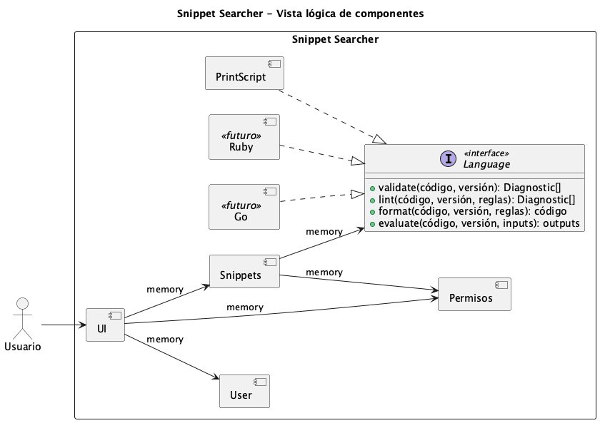
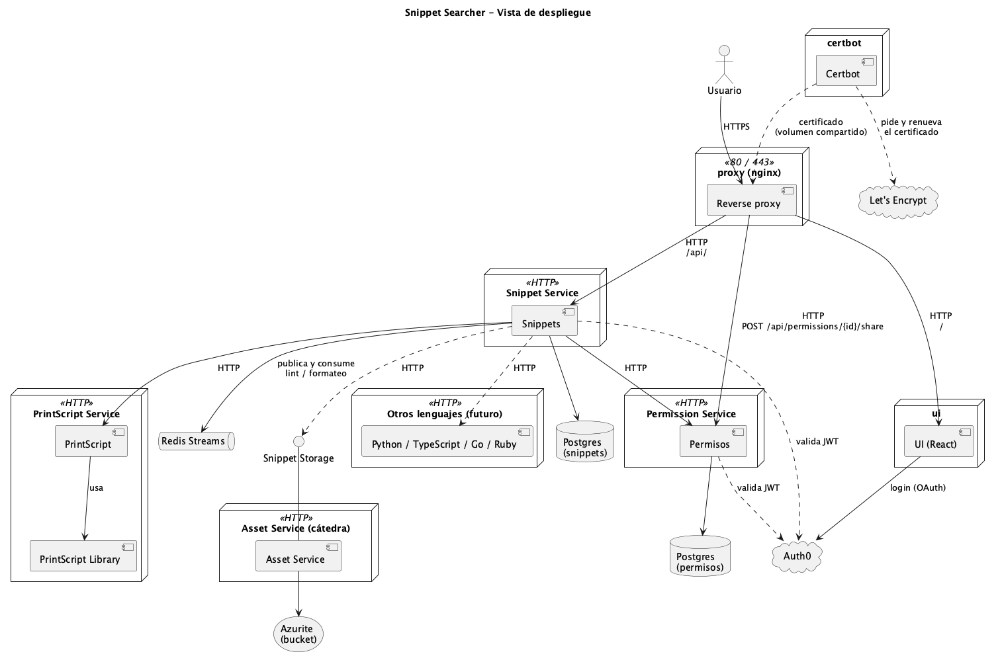

# SnippetSearcher

Plataforma web para guardar, compartir, ejecutar, formatear, lintear y testear snippets de código. Por ahora el único lenguaje soportado es **PrintScript**, pero la plataforma tiene que estar preparada para sumar otros lenguajes.

Trabajo práctico de Ingeniería de Sistemas, Universidad Austral (2026).

## Documentación de la cátedra

| Documento | Contenido |
|---|---|
| [Consigna](docs/Snippet%20Searcher%20-%20Consigna%20%281%29.pdf) | Descripción del TP, casos de uso generales y primer entregable |
| [Casos de uso (User Stories)](docs/Snippet%20Searcher%20-%20Casos%20de%20uso.pdf) | Las 16 user stories con sus notas y criterios |

## Casos de uso generales

- Guardar, editar, compartir, ejecutar, formatear y validar snippets.
- Definir casos de prueba para los snippets.
- Re-evaluar y validar **todos** los snippets con cada nueva versión del parser.
- Sin usuarios anónimos: todo acceso requiere autenticación/autorización (se delega en **Auth0**).

A lo largo del cuatrimestre se irán sumando requerimientos no funcionales.

## Primer entregable

- [ ] Arquitectura de la plataforma: UI web, N servicios, bases de datos, etc.
- [ ] User stories que reflejen las funcionalidades.
- [x] Diagrama de componentes de la arquitectura ([ver](#arquitectura)).
- [ ] Diagramas de secuencia de los workflows más importantes.

## User stories

Los roles (desarrollador, administrador, investigador, owner) solo indican el punto de vista de cada historia; **no** hace falta implementar permisos por rol por ahora.

| # | Historia | Rol | Puntos clave |
|---|---|---|---|
| 1 | Crear snippet mediante archivo | Desarrollador | Nombre, descripción, lenguaje y versión. Se rechaza si no parsea, indicando la regla violada, la línea y la columna. |
| 2 | Actualizar snippet mediante archivo | Desarrollador | El owner puede actualizar el contenido y todos los metadatos. Se aplica la misma validación. |
| 3 | Crear snippet en editor | Desarrollador | Editor embebido en el browser, con los mismos requisitos que la #1. |
| 4 | Actualizar snippet en editor | Desarrollador | Mismos requisitos que la #2. |
| 5 | Listar snippets | Administrador | Filtro por relación (propios, compartidos o ambos). Muestra la validez según el linting. Permite filtrar y ordenar por nombre, lenguaje y validez. |
| 6 | Ver un snippet | Administrador | Muestra nombre, descripción, lenguaje, contenido, reglas de linting incumplidas y tests (ejecutables). |
| 7 | Compartir snippet | Owner | Selector de usuarios con filtro a medida que se escribe. El usuario invitado tiene permiso de **solo lectura** sobre el snippet y sus tests. |
| 8 | Crear tests | Desarrollador | Un test es una lista ordenada de inputs y otra de outputs esperados (en el orden de los `println`). Se permiten tests que fallan. |
| 9 ⏳ | Correr un test | Investigador | Un test a la vez, con el output en streaming. |
| 10 ⏳ | Ejecución interactiva | Investigador | El usuario da los inputs a medida que se piden y ve los outputs a medida que se imprimen. |
| 11 | Habilitar reglas de formateo | Administrador | Activar y desactivar reglas. Por ahora solo las reglas predeterminadas de PrintScript. |
| 12 ⏳ | Formateo automático | Administrador | Asíncrono y tolerante a fallos: retoma desde donde falló o saltea el snippet problemático. |
| 13 | Descargar snippet | Investigador | Versión original y versión formateada. |
| 14 | Habilitar reglas de linting | Administrador | Activar y desactivar reglas. Por ahora solo las predeterminadas de PrintScript. |
| 15 ⏳ | Linting automático | Administrador | Asíncrono y tolerante a fallos, igual que la #12. |
| 16 | Testing automático | Desarrollador | Al modificar un snippet se corren todos sus tests. El resultado **no** bloquea ni revierte el update. |

⏳ = la cátedra va a explicar más adelante cómo implementarlas.

> No hay que desarrollar la UI; solo configurarla para que funcione con nuestros servicios.

## Implicancias técnicas a tener en cuenta

Conclusiones que surgen de la consigna y conviene considerar al diseñar la arquitectura:

- **Multi-lenguaje desde el diseño.** El lenguaje y su versión son atributos del snippet. El parser, linter, formatter y runner deberían estar detrás de una abstracción por lenguaje.
- **Errores con ubicación.** La validación tiene que devolver la regla violada, la línea y la columna, no solo un "inválido".
- **Procesamiento masivo asíncrono.** El formateo y linting automáticos (#12, #15) y la re-validación por nueva versión del parser recorren muchos snippets. Hacen falta jobs en background con reintentos, checkpoints y la posibilidad de saltear snippets que fallen (por ejemplo, una cola de mensajes).
- **Ejecución con streaming bidireccional.** Las historias #9 y #10 piden inputs y outputs en tiempo real (por ejemplo, WebSockets o SSE), no una respuesta al final.
- **Permisos por snippet.** Hay owners y usuarios con acceso de lectura. La autenticación se delega en Auth0 y la autorización sobre cada snippet es nuestra.
- **Dos versiones del contenido.** Hay que guardar (o poder generar) la versión original y la formateada (#13).

## Definiciones a considerar
- Un snippet es un fragmento chico de código que se guarda para reutilizarlo, compartirlo o consultarlo después.
- Snippet Searcher: es una plataforma que entiende el código no lo guarda como texto plano, sino que tiene detrás el intérprete y las herramientas de PrintScript para trabajar con él.

## Qué se puede hacer con un snippet?
1. Validar (parsear). Si el código no respeta la sintaxis de PrintScript, no
   se guarda. Hay que indicar qué regla se rompió, en qué línea y en qué
   columna.
2. Lintear. Detecta problemas de estilo o de calidad aunque el código sea
   válido. Un ejemplo sería una regla del tipo "las variables en camelCase".
   El snippet se guarda igual, pero queda marcado como que no cumple.
3. Formatear. Reescribe el código para que cumpla las reglas de estilo, por
   ejemplo espacios o saltos de línea.
4. Ejecutar. Corre el snippet de forma interactiva: si llama a readInput, la
   plataforma le pide el valor al usuario en ese momento, y los println se ven a medida que ocurren.
5. Testear. Un test es una lista de inputs y una lista de outputs esperados.
   Se ejecuta el snippet con esos inputs y se compara lo que imprime con lo
   esperado. Los tests se corren solos cada vez que se modifica el snippet.
6. Compartir y descargar.


## Ejemplo de un snippet

Un snippet completo tal como viviría en la plataforma: código, metadatos, tests y qué pasa al validarlo, lintearlo y formatearlo.

### Ejemplo con código (PrintScript 1.1)
```
const nombre: string = readInput("Nombre:");
let edad: number = readInput("Edad:");

let saludo: string = "Hola " + nombre;
println(saludo);

if (edad > 17) {
    println("Sos mayor de edad");
} else {
    println("Sos menor de edad");
}
```

`const`, `readInput` e `if/else` existen a partir de PrintScript 1.1; la 1.0 solo tiene `let`, `println` y expresiones.

### Qué guarda la plataforma

| Dato | Valor | Dónde se guarda |
|---|---|---|
| id | `42` | Postgres (snippets) |
| Nombre | `saludo-por-edad` | Postgres (snippets) |
| Descripción | "Saluda al usuario y le dice si es mayor de edad" | Postgres (snippets) |
| Lenguaje / versión | PrintScript `1.1` | Postgres (snippets) |
| Estado de lint | `COMPLIANT` | Postgres (snippets) |
| Contenido | el código de arriba | Bucket (Snippet Storage) |
| Owner | `auth0\|martina` | Permisos |
| Compartido con | `auth0\|juan` (solo lectura) | Permisos |

### Tests (#8)
Los inputs se entregan en orden a cada `readInput`, y los outputs esperados se comparan en orden con cada `println`.

| Test | Inputs | Outputs esperados | Resultado |
|---|---|---|---|
| mayor de edad | `["Ana", 25]` | `["Hola Ana", "Sos mayor de edad"]` | ✅ pasa |
| menor de edad | `["Leo", 12]` | `["Hola Leo", "Sos menor de edad"]` | ✅ pasa |
| test mal escrito | `["Ana", 25]` | `["Hola Ana", "Sos menor de edad"]` | ❌ falla (la consigna permite guardar tests así) |

Cada vez que se edita el snippet, sus tests se corren automáticamente (#16).

> A confirmar: si los prompts de `readInput` ("Nombre:", "Edad:") cuentan como outputs depende de cómo lo implemente el intérprete.

### Qué pasa con versiones "malas" del snippet

**Error de sintaxis: el snippet se rechaza (#1)**

```
let saludo: string = "Hola " + nombre
println(saludo);
```

> ❌ Snippet inválido: falta `;` al final de la declaración. Línea 1, columna 38.

No se guarda nada.

**Válido pero no cumple el linter: se guarda y queda marcado**

```
let mi_saludo: string = "Hola " + nombre;
println("Hola " + nombre);
```

> ⚠️ `mi_saludo` no respeta el formato camelCase (línea 1, columna 5).
> ⚠️ `println` solo acepta un identificador o un literal, no una expresión (línea 2, columna 9).

El snippet queda en estado `NOT_COMPLIANT`, visible en el listado (#5) y en el detalle (#6).

**Formato desprolijo: el formatter lo corrige (#11, #12)**

Antes:

```
let   edad:number=readInput("Edad:");println(edad);
```

Después:

```
let edad: number = readInput("Edad:");
println(edad);
```

La descarga (#13) ofrece las dos versiones: la original y la formateada.

### Ejecución interactiva (#10)

```
> Nombre:        ← la plataforma pide el input
  Martina        ← el usuario escribe
< Hola Martina   ← el output aparece en el momento
> Edad:
  30
< Sos mayor de edad
```

Las reglas concretas de lint y formateo (camelCase o snake_case, espacios alrededor de `:` y `=`, saltos de línea antes de `println`, indentación del `if`, etc.) dependen de la versión de PrintScript que provea la cátedra. Las de arriba son ejemplos ilustrativos.

## Arquitectura

La arquitectura sigue el formato que propusieron los profesores en clase ([foto del pizarrón](docs/diagramas/PizarronArquitecturaDiagrama.jpeg)). Se describe en dos diagramas de componentes UML, escritos en PlantUML dentro de [`docs/diagramas/`](docs/diagramas):

| Diagrama | Fuente | Qué muestra |
|---|---|---|
| Vista lógica | [`componentes-logico.puml`](docs/diagramas/componentes-logico.puml) | Los módulos del sistema, la interfaz `Language` y cómo dependen entre sí, sin importar cómo se despliegan |
| Vista de despliegue | [`componentes-despliegue.puml`](docs/diagramas/componentes-despliegue.puml) | Qué servicios HTTP existen, qué base de datos usa cada uno, dónde se guarda el código y cómo interviene Auth0 |

### Vista lógica

Las conexiones `memory` indican que, a nivel lógico, los módulos se llaman como si estuvieran en el mismo proceso. La clave de este diagrama es que **Snippets depende de la interfaz `Language` y no de PrintScript directamente**. Cada lenguaje (PrintScript hoy; Go o Ruby en el futuro) implementa esa interfaz, así que agregar un lenguaje no requiere modificar Snippets.

### Vista de despliegue

Cada módulo se despliega como un servicio independiente con API HTTP. Snippets y Permisos tienen **cada uno su propio Postgres**. El **código de los snippets no va a Postgres**: se guarda en un bucket, detrás de la interfaz `Snippet Storage`, y tanto Snippets como los servicios de lenguaje lo leen desde ahí.

## Roles
Los roles de las user stories describen **puntos de vista**, no permisos distintos en el sistema. Hoy cualquier usuario autenticado puede hacer todo sobre sus propios snippets. La única distinción real que el sistema aplica es **owner vs. usuario con quien se compartió el snippet**.

| Rol | Qué hace | User stories |
|---|---|---|
| **Desarrollador** | Crea y actualiza snippets (desde un archivo o desde el editor), escribe tests y espera que se corran solos al modificar el código | #1, #2, #3, #4, #8, #16 |
| **Administrador** | Gestiona un conjunto de snippets: los lista, filtra y ordena, ve su detalle y su validez, y configura las reglas de linting y formateo que se aplican a todos ellos | #5, #6, #11, #12, #14, #15 |
| **Investigador** | Estudia snippets a los que tiene acceso: los ejecuta de forma interactiva, corre sus tests y los descarga | #9, #10, #13 |
| **Owner** | El creador del snippet. Es el único que puede editarlo, borrarlo y compartirlo | #2, #7 |
| **Usuario con acceso compartido** | Alguien con quien el owner compartió un snippet. Tiene permiso de **solo lectura** sobre el snippet y sus tests | #7 |

Todos los roles son usuarios autenticados con Auth0: no existen usuarios anónimos.

## Módulos

| Módulo | Responsabilidad | Guarda datos en |
|---|---|---|
| **UI** | Interfaz web (React) provista por la cátedra: pantallas, editor embebido, login. Solo hay que configurarla para que apunte a nuestros servicios | — |
| **Auth0** (externo) | Login, emisión de tokens JWT y registro de usuarios | Auth0 |
| **User** | Expone los usuarios del sistema. Por ejemplo, la búsqueda de usuarios que filtra a medida que se escribe al compartir un snippet (#7). Se apoya en Auth0, no mantiene una tabla de usuarios propia | Auth0 |
| **Snippets** | Módulo central. Guarda los metadatos del snippet (nombre, descripción, lenguaje, versión, estado de lint), los tests y la configuración de reglas. Orquesta la validación, el lint, el formateo y la ejecución delegándolas en el lenguaje correspondiente | Postgres (snippets) + Snippet Storage |
| **Permisos** | Decide quién puede hacer qué sobre cada snippet: registra al owner y a los usuarios con quienes se compartió, y responde consultas del tipo "¿este usuario puede leer o escribir este snippet?" | Postgres (permisos) |
| **Language** (interfaz) | Contrato común que todo lenguaje debe cumplir: `evaluate` (ejecutar), `lint` y `format`. La validación sintáctica ocurre como parte de estas operaciones | — |
| **PrintScript** | Implementación de `Language` para PrintScript. Usa la **PrintScript Library** (lexer, parser, intérprete, linter y formatter) | — |
| **Otros lenguajes** (futuro) | Python, TypeScript, Go, Ruby, etc. Serían nuevas implementaciones de `Language`, desplegadas como servicios iguales a PrintScript | — |
| **Snippet Storage** (interfaz) / **Bucket Storage** | Guarda y entrega el contenido (código) de los snippets como archivos en un bucket | Bucket |

## Dependencias entre módulos

| Módulo | Depende de | Para qué |
|---|---|---|
| UI | Auth0 | Iniciar sesión y obtener el token |
| UI | Snippets | Todas las operaciones sobre snippets, tests y reglas |
| UI | Permisos | Compartir snippets y consultar accesos |
| UI | User | Buscar usuarios al compartir |
| Snippets | Permisos | Verificar que el usuario puede leer o modificar un snippet, y registrar al owner al crearlo |
| Snippets | Language (PrintScript) | Validar, lintear, formatear y ejecutar el código |
| Snippets | Snippet Storage | Guardar y leer el contenido del snippet |
| Snippets, Permisos | Auth0 | Validar el JWT de cada request y obtener el `userId` |
| PrintScript (y otros lenguajes) | Snippet Storage | Leer el código del snippet a partir de su id, sin que Snippets tenga que mandarlo completo |
| PrintScript | PrintScript Library | Toda la lógica del lenguaje |

Reglas de diseño que salen de estas dependencias:

- **Nadie depende de Snippets salvo la UI.** Snippets orquesta; Permisos, los lenguajes y el storage no conocen a Snippets.
- **Snippets no conoce ningún lenguaje concreto**, solo la interfaz `Language`.
- **Cada servicio es dueño de sus datos.** Snippets no lee la base de Permisos ni al revés: se comunican por HTTP.
- **No hay dependencias circulares.**

La cola de mensajes para el formateo y linting masivo (#12, #15) no aparece en los diagramas porque la cátedra la va a explicar más adelante. Cuando se agregue, Snippets publicaría los trabajos y los servicios de lenguaje los consumirían.

## Ejemplo: crear un snippet de punta a punta

1. La UI manda `POST /snippets` al Snippet Service con el código y el token de Auth0.
2. El Snippet Service valida el token y obtiene el `userId`.
3. Pide al servicio del lenguaje (PrintScript) que valide el código:
   - Si es inválido, responde **400** con la regla violada, la línea y la columna.
4. Si es válido:
   - guarda el contenido en **Snippet Storage**;
   - guarda los metadatos en **Postgres (snippets)**;
   - registra al usuario como owner en **Permisos**.
5. Lintea el snippet y actualiza su estado de validez.
6. Corre los tests del snippet, si tiene (#16).

## Decisiones técnicas

Fuente de verdad sobre qué está decidido. Lo que figura como **Pendiente** no se asume: se consulta con el equipo antes de implementarlo, y la decisión se registra acá.

| Tema | Estado | Detalle |
|---|---|---|
| Arquitectura de servicios | ✅ Definido | Ver [Arquitectura](#arquitectura) y [Dependencias entre módulos](#dependencias-entre-módulos) |
| Autenticación | ✅ Definido | Auth0 (lo indica la cátedra) |
| Lenguaje, framework y build | ✅ Definido | **Java 21 + Spring Boot 4.1.1 + Gradle 9.8** (Groovy DSL, con wrapper) |
| Contenedores | ✅ Definido | Un `Dockerfile` por servicio; `docker-compose.yml` por repo y `docker-compose.sistema.yml` en este repo, que incluye los de cada repo para levantar todo. Todos comparten el proyecto `snippet-searcher`, así que los contenedores y los datos son los mismos se levante un servicio solo o el sistema. Ver [Cómo levantarlo](#cómo-levantarlo) |
| Publicación de la imagen | ✅ Definido | En cada push a `dev` o `main`, GitHub Actions (`.github/workflows/cd.yml`) arma la imagen y la publica en GHCR como `ghcr.io/martinacousido/snippet-service`, con el tag del ambiente (`dev` o `prod`) y el del commit (`sha-…`). La imagen es pública. Ver [Tags de las imágenes](https://github.com/MartinaCousido/SnippetSearcher-infra#tags-de-las-imágenes) en el repo de infra |
| Deploy del servicio | ✅ Definido | Después de publicar la imagen, el mismo workflow entra por SSH a la VM del ambiente (`dev` → VM de dev, `main` → VM de prod) y corre `docker service update` con el tag `sha-…` del commit. Actualiza **solo** `snippet-service`: los demás servicios del stack no se reinician. Usa los secrets `VM_HOST`, `VM_USER` y `VM_SSH_KEY` de los *Environments* `dev` y `prod` de este repo. La VM tiene que estar prendida |
| Librería de PrintScript | ⏳ Pendiente | Cuál se usa (propia o de la cátedra), versión y dónde está publicada |
| Contrato con la UI de la cátedra | ⏳ Pendiente | Repo de la UI, endpoints y DTOs que espera |
| Snippet Storage (bucket) | ⏳ Pendiente | Si lo provee la cátedra o se implementa |
| Base de datos | ✅ Definido | **PostgreSQL 17, un contenedor por servicio** (`snippets` y `permisos`). Ningún servicio accede a la base de otro |
| Migraciones | ⏳ Pendiente | Herramienta a definir (por ejemplo Flyway). Mientras tanto, `ddl-auto: none` |
| Framework de tests | ✅ Definido | **JUnit 5**, con los starters de test de Spring Boot (lo que genera Spring Initializr). Los tests necesitan la base levantada. Ver [Correr los tests](#correr-los-tests) |
| Linter y cobertura | ⏳ Pendiente | Linter y cobertura mínima |
| Cola de mensajes | ⏳ Pendiente | La cátedra la explica más adelante (#12, #15) |

## Flujo de trabajo

Aplica igual a los tres repos: SnippetSearcher, SnippetPermission y SnippetSearcher-infra.

```
feature/us-<n>-<descripcion>  ──PR──▶  dev  ──PR──▶  main
                                        │             │
                                        ▼             ▼
                                   VM de dev     VM de prod
```

1. Cada user story o tarea se desarrolla en su propia rama, creada desde `dev` (`feature/`, `docs/`, `fix/`…). Los pushes van a esa rama.
2. Se abre un PR hacia `dev`. **Las correcciones de los PRs las hace Martina Cousido**, con la skill [`corregir-prs`](.claude/skills/corregir-prs/SKILL.md).
3. Al mergear en `dev`, el cambio se despliega en la **VM de dev**.
4. Lo probado en dev pasa a `main` con un PR `dev` → `main`. Al mergear, se despliega en la **VM de prod**.
5. Al mergear un PR, se cierra el issue que resuelve.

### Cómo se mergea

| PR | Tipo de merge | Por qué |
|---|---|---|
| rama de tarea → `dev` | **Squash** | Junta los commits del PR en uno solo y deja `dev` prolijo |
| `dev` → `main` | **Merge commit** | Mantiene la misma historia en las dos ramas. Con squash, `main` tendría un commit que `dev` no tiene, y el siguiente PR `dev` → `main` mostraría cambios viejos o conflictos falsos |

### Protección de `dev` y `main`

Configurada en GitHub con *rulesets* (*Settings → Rules → Rulesets*). **Proteger dev y main** está igual en los tres repos. **CI obligatorio en dev y main** está solo en SnippetSearcher y SnippetPermission, porque infra no tiene código que compilar:

| Regla | Valor | Por qué |
|---|---|---|
| PR obligatorio | Sí, para todos | Nadie pushea directo a `dev` ni a `main`: GitHub rechaza el push. Los cambios entran solo mergeando un PR |
| Aprobaciones requeridas | 1 | Todo PR necesita que otra persona lo apruebe antes de mergearse |
| Excepción | Administradora del repo (Martina), **solo en PRs** | GitHub no deja que el autor apruebe su propio PR. Con la excepción, Martina puede mergear sus PRs sin aprobación; GitHub le pide confirmarlo y queda registrado. Un push directo se le rechaza igual. Los compañeros, como colaboradores con permiso de escritura, no tienen la excepción |
| Force push y borrar la rama | Bloqueados | Evita perder historia |
| CI obligatorio | Sí, **sin excepciones** | El check **`compilar-y-testear`** tiene que estar en verde para mergear a `dev` y `main`: si no compila o falla un test, el PR no entra. Está en un ruleset aparte (**CI obligatorio en dev y main**) que no tiene excepción para nadie, ni siquiera para la administradora. Así, la excepción del PR sin aprobación no permite saltear el CI. Ver [Correr los tests](#correr-los-tests) |

Commits en español con formato `tipo(scope): resumen`. Detalle en [`CLAUDE.md`](CLAUDE.md).

## Cómo levantarlo

Requisitos: Docker Desktop abierto. No hace falta instalar Java ni Gradle: se compila dentro de Docker.

Primero, crear el archivo `.env` con las variables (no se commitea):

```bash
cp .env.example .env
```

Si se quiere cambiar la contraseña de la base, hay que hacerlo en el `.env` **antes del primer arranque**: Postgres la toma solo cuando crea la base por primera vez. Para cambiarla después hay que borrar los datos (`down -v`) y volver a levantar.

**Sistema completo** (Snippet Service + Permission Service, cada uno con su base). Requiere el repo [SnippetPermission](https://github.com/MartinaCousido/SnippetPermission) clonado al lado de este (`../SnippetPermission`), con su propio `.env` creado:

```bash
docker compose -f docker-compose.sistema.yml up --build
```

**Solo Snippet Service** y su base:

```bash
docker compose up --build
```

`docker-compose.sistema.yml` no repite la definición de los servicios: incluye el `docker-compose.yml` de cada repo, y cada uno toma las variables de su propio `.env`. Todos usan el mismo proyecto de Docker (`snippet-searcher`), así que los contenedores y los datos son los mismos se levante un servicio solo o el sistema completo.

| Contenedor | URL / puerto en tu máquina |
|---|---|
| Snippet Service | http://localhost:8080 |
| Permission Service | http://localhost:8081 |
| Postgres `snippets` | `localhost:5433` |
| Postgres `permisos` | `localhost:5434` |

Los puertos de Postgres solo se publican en `127.0.0.1`: las bases no son accesibles desde otras máquinas de la red.

Para comprobar que un servicio está arriba y conectado a su base: http://localhost:8080/actuator/health (o `8081`) tiene que responder `"status":"UP"`, con `db` también en `UP`.

Para bajar todo: `docker compose -f docker-compose.sistema.yml down`. Los datos quedan en volúmenes de Docker; para borrarlos también, agregar `-v`.

### Correr los tests

Los tests levantan el servicio completo, así que necesitan la base arriba y las variables de conexión. Con la base levantada (`docker compose up -d snippets-db`):

```bash
DB_URL=jdbc:postgresql://localhost:5433/snippets DB_USER=<usuario> DB_PASSWORD=<contraseña> ./gradlew test
```

Usuario y contraseña son los del `.env`. Sin la base, `./gradlew build` y `./gradlew test` fallan; la imagen de Docker se arma igual porque solo ejecuta `bootJar`.

En cada PR hacia `dev` o `main`, el CI (`.github/workflows/ci.yml`) corre `./gradlew build` con una base Postgres 17 descartable. Su check se llama `compilar-y-testear` y es obligatorio para mergear.

## Estructura del repositorio

```
.
├── .claude/skills/                    # Skills del proyecto para Claude Code
├── .github/workflows/ci.yml           # Compila y testea en cada PR
├── .github/workflows/cd.yml           # Publica la imagen y actualiza el servicio en la VM
├── CLAUDE.md                          # Reglas para Claude Code en este repo
├── docs/
│   ├── diagramas/                     # Diagramas de componentes (PlantUML + PNG) y fotos del pizarrón
│   └── *.pdf                          # Consigna y user stories de la cátedra
├── src/                               # Código de Snippet Service (Java + Spring Boot)
├── build.gradle, settings.gradle      # Build con Gradle
├── gradlew, gradle/                   # Wrapper de Gradle (no hace falta instalar Gradle)
├── Dockerfile                         # Imagen de Snippet Service
├── .dockerignore                      # Lo que no entra a la imagen
├── docker-compose.yml                 # Snippet Service + su base
├── docker-compose.sistema.yml         # Sistema completo (incluye el compose de cada repo)
├── .env.example                       # Variables necesarias; copiar a .env
├── .gitignore
└── README.md
```

### Editar los diagramas

Los `.puml` son la fuente; los `.png` se generan a partir de ellos. Después de editar un `.puml`, regenerá su imagen:

```bash
# con PlantUML instalado (brew install plantuml)
plantuml -tpng docs/diagramas/*.puml
```

También se pueden previsualizar con la extensión de PlantUML de IntelliJ o VS Code.
